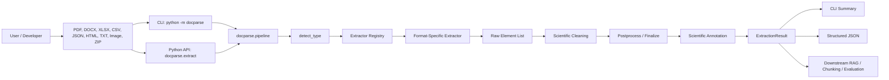
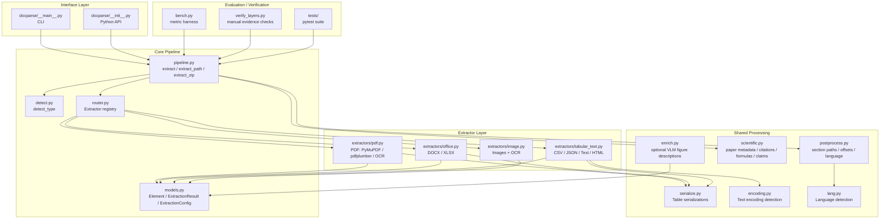
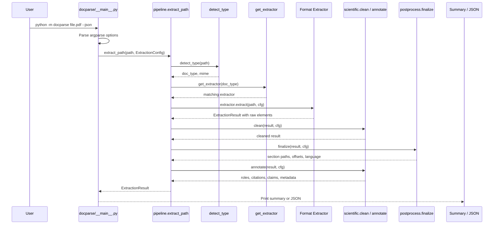
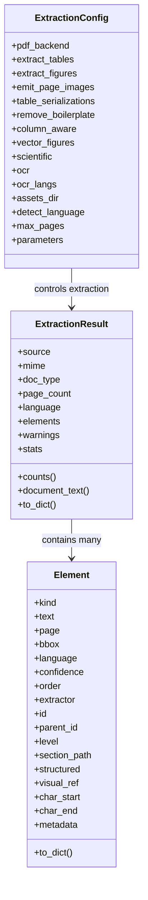
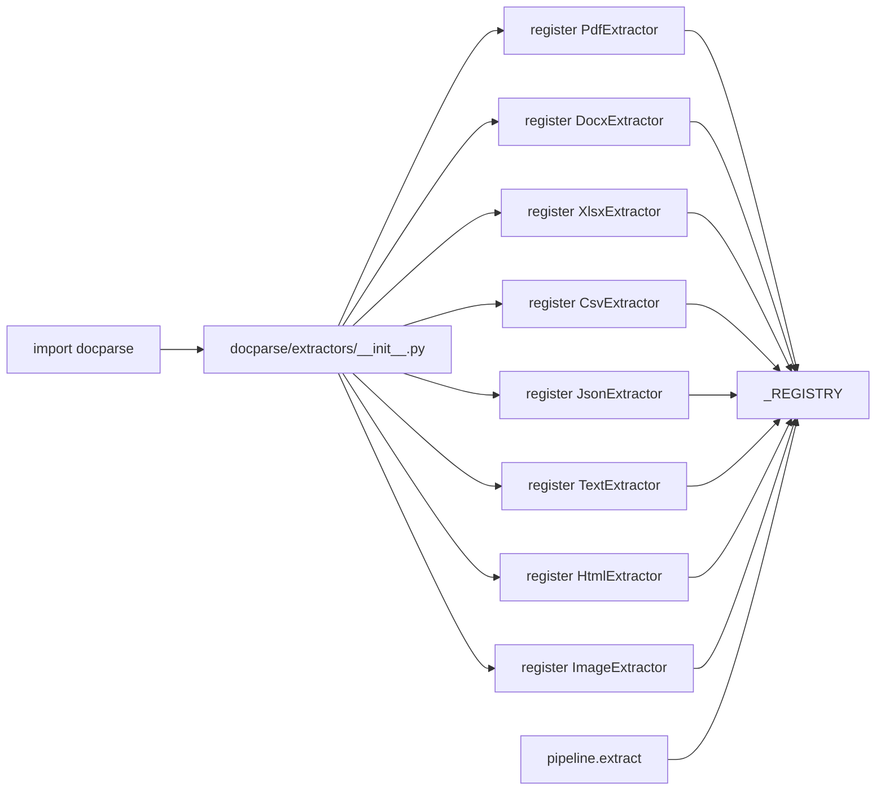
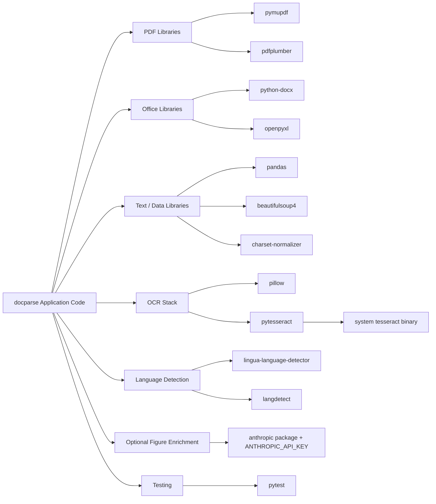
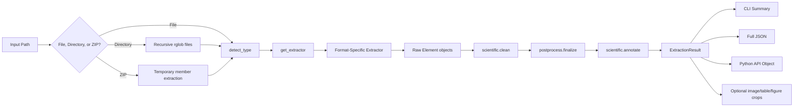
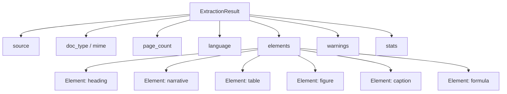
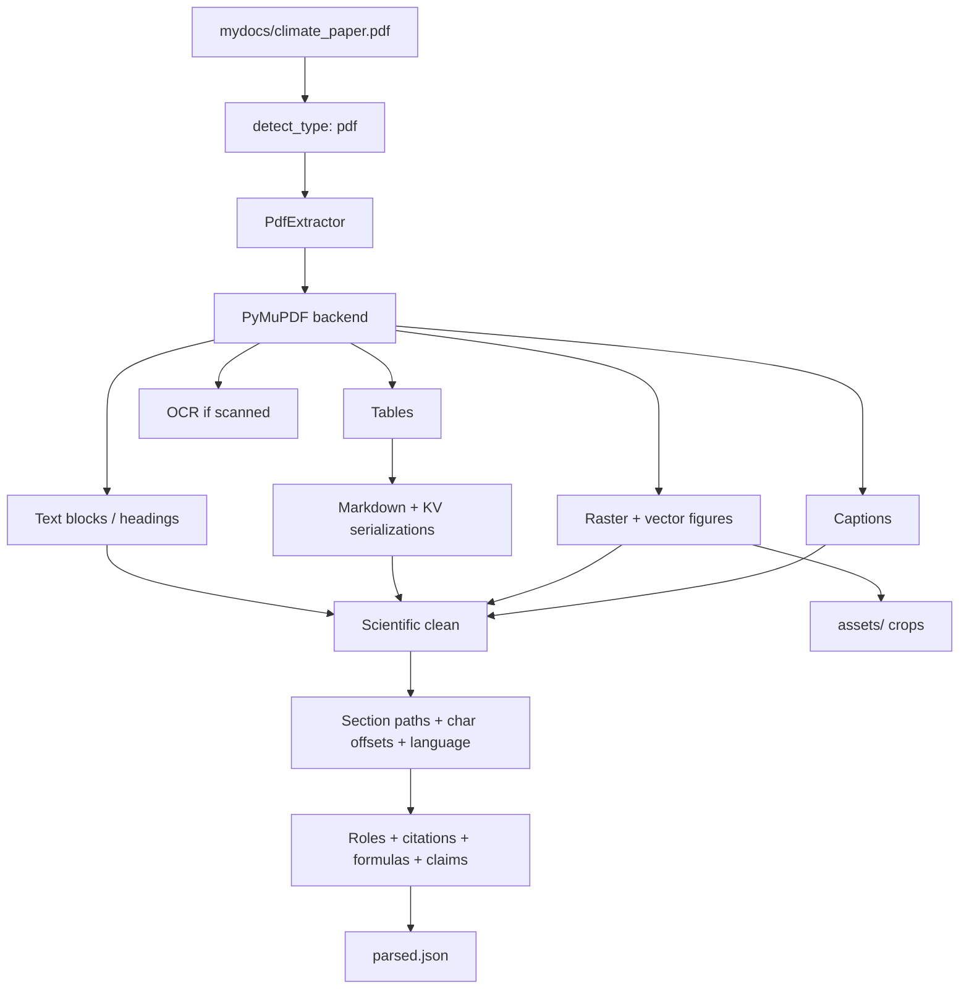
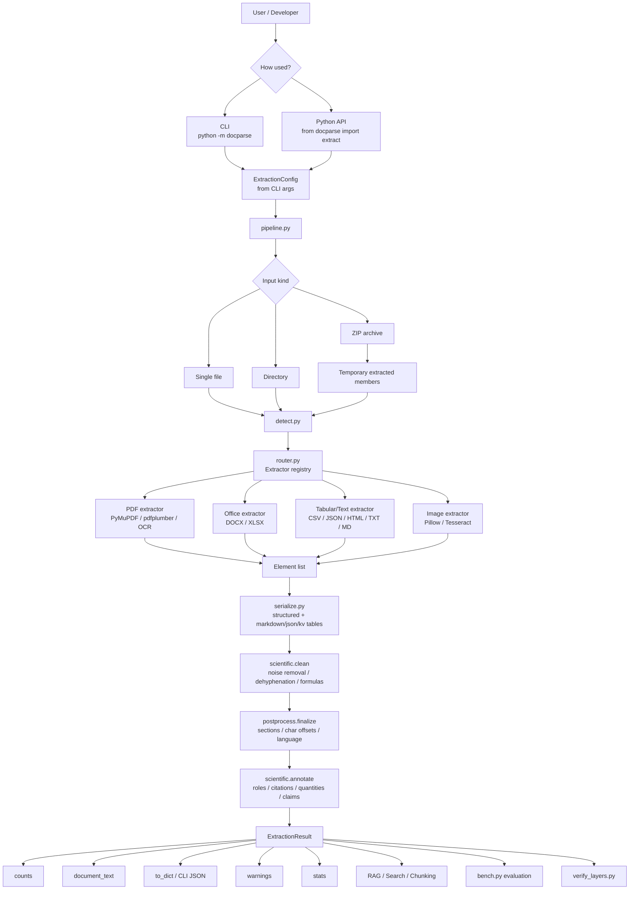

# docparse

`docparse` is a reusable Python document-extraction library and CLI for converting many document formats into one consistent, provenance-bearing element schema. It supports PDFs, DOCX, XLSX, CSV/TSV, JSON/JSONL, HTML, plain text/Markdown, and images. The system is especially strong for RAG and scientific-document preprocessing because it preserves structure, reading order, tables, figures, captions, OCR text, section paths, character offsets, citations, formulas, quantities, and extraction metadata.

| Area              | Description |
| ----------------- | ----------- |
| Project type      | Python document parsing / extraction library with CLI |
| Main language     | Python |
| Frameworks        | No web framework; library + command-line interface |
| Main entry point  | `docparse/__main__.py` via `python -m docparse ...` |
| Storage           | No database; optional asset files written to `assets_dir` |
| External services | Optional Anthropic API for figure descriptions |
| Testing           | `pytest` tests in `tests/`; benchmark harness in `docparse/bench.py` |
| Main schema       | `Element`, `ExtractionResult`, `ExtractionConfig` in `docparse/models.py` |
| Supported inputs  | PDF, DOCX, XLSX, CSV, TSV, JSON, JSONL, HTML, TXT, MD, image files, ZIP archives |
| Main output       | Summary text or structured JSON extraction results |

---

# 1. What This Project Does

`docparse` solves a common problem in RAG, search, document intelligence, and research pipelines: different file formats expose content in completely different ways. A PDF may contain text blocks, figures, vector charts, scanned pages, tables, formulas, headers, and footers. A DOCX file may contain styled headings, embedded images, and Word tables. A CSV or Excel file is already tabular. A JSON file may contain nested structured evidence.

This project normalizes all of those into a single list of `Element` objects.

Each extracted `Element` records:

- what it is: `heading`, `narrative`, `table`, `figure`, `caption`, `formula`, etc.
- where it came from: source path, page number, bounding box, character offsets
- how it was extracted: `pymupdf`, `pdfplumber`, `python-docx`, `openpyxl`, `pandas`, `tesseract`, etc.
- how it connects to other content: section path, parent IDs for captions, table structure, visual references
- useful metadata: language, role, citations, quantities, claims, warnings, confidence

The result is a document parser designed for downstream chunking, retrieval, evaluation, and scientific-document analysis.



---

# 2. Repository Structure

```text
project-root/
├── .gitignore
├── requirements.txt
├── verify_layers.py
├── docparse/
│   ├── __init__.py
│   ├── __main__.py
│   ├── bench.py
│   ├── detect.py
│   ├── encoding.py
│   ├── enrich.py
│   ├── lang.py
│   ├── models.py
│   ├── pipeline.py
│   ├── postprocess.py
│   ├── router.py
│   ├── scientific.py
│   ├── serialize.py
│   ├── table_md.py
│   └── extractors/
│       ├── __init__.py
│       ├── image.py
│       ├── office.py
│       ├── pdf.py
│       └── tabular_text.py
├── tests/
│   ├── __init__.py
│   ├── make_golden.py
│   ├── test_scientific.py
│   └── test_smoke.py
└── mydocs/
    └── climate_paper.pdf
```

| Path | Purpose | Why it matters |
| ---- | ------- | -------------- |
| `docparse/__init__.py` | Public package API | Exposes `extract`, `extract_path`, `extract_zip`, `ExtractionConfig`, `Element`, and registry helpers |
| `docparse/__main__.py` | CLI entry point | Enables `python -m docparse file.pdf --summary` and `python -m docparse file.pdf --json` |
| `docparse/models.py` | Core data model | Defines the common schema used by every extractor |
| `docparse/pipeline.py` | Dispatch pipeline | Detects type, selects extractor, runs cleaning/finalization/annotation |
| `docparse/router.py` | Extractor registry | Allows built-in and custom extractors to be registered by document type |
| `docparse/detect.py` | File-type detection | Maps extensions and MIME types to internal types like `pdf`, `docx`, `csv`, `image` |
| `docparse/encoding.py` | Robust text decoding | Handles BOMs, `charset-normalizer`, UTF-8, CP1252, and Latin-1 fallback |
| `docparse/lang.py` | Language detection | Uses `lingua` when available, falls back to `langdetect` |
| `docparse/postprocess.py` | Format-agnostic finalization | Adds section paths, char offsets, language fields, and list promotion |
| `docparse/scientific.py` | Scientific-document enrichment | Cleans license noise, fixes hyphenation, detects formulas, roles, citations, quantities, and claims |
| `docparse/serialize.py` | Table serialization | Converts rows into Markdown, JSON, key-value text, and structured tables |
| `docparse/enrich.py` | Optional VLM figure description | Uses Anthropic API to describe figure crops if configured |
| `docparse/bench.py` | Extraction evaluation harness | Measures heading precision/recall, reading order, table cell F1, OCR CER |
| `docparse/extractors/pdf.py` | PDF extractor | Main heavy extractor using PyMuPDF, pdfplumber fallback, OCR, tables, figures, captions |
| `docparse/extractors/office.py` | DOCX/XLSX extractors | Extracts Word paragraphs, headings, tables, embedded figures, and Excel sheets |
| `docparse/extractors/tabular_text.py` | CSV/JSON/Text/HTML extractors | Handles structured and text-based formats |
| `docparse/extractors/image.py` | Image extractor | Emits page image metadata and optional OCR text |
| `tests/test_smoke.py` | Main smoke and structure tests | Verifies registry, text, CSV, JSON, DOCX, PDF, fallback, benchmark, CRLF handling |
| `tests/test_scientific.py` | Scientific enrichment tests | Verifies dehyphenation, noise removal, formulas, roles, citations, claims, climate-paper integration |
| `tests/make_golden.py` | Synthetic test corpus builder | Creates PDF/DOCX fixtures with ground truth for testing |
| `verify_layers.py` | Manual verification script | Runs layer-by-layer checks on a real scientific PDF |
| `mydocs/climate_paper.pdf` | Example scientific paper | Used by integration tests and `verify_layers.py` |

---

# 3. System Architecture



## Main architectural idea

The project separates document extraction into four layers:

| Layer | Responsibility | Key files |
| ----- | -------------- | --------- |
| Interface | CLI and importable API | `__main__.py`, `__init__.py` |
| Dispatch | Detect input type and route to extractor | `pipeline.py`, `detect.py`, `router.py` |
| Extraction | Format-specific parsing | `extractors/pdf.py`, `office.py`, `tabular_text.py`, `image.py` |
| Normalization / enrichment | Make outputs consistent and useful for retrieval | `models.py`, `postprocess.py`, `scientific.py`, `serialize.py`, `lang.py` |

The important design decision is that every extractor emits the same `Element` schema. This means downstream code does not need separate logic for PDFs, Word files, Excel sheets, CSVs, JSON files, or images.

---

# 4. Runtime Flow

The main command is:

```bash
python -m docparse <path> --summary
```

or:

```bash
python -m docparse <path> --json
```

Example:

```bash
python -m docparse mydocs/climate_paper.pdf --summary
```

Observed summary-style output:

```text
mydocs/climate_paper.pdf
    type=pdf pages=17 lang=None backend=pymupdf
    elements: heading:4, narrative:13
```

The exact element counts depend on CLI options such as `--pages`, OCR settings, table extraction, scientific enrichment, and asset generation.



Step-by-step:

1. The user starts the system through `python -m docparse ...`.
2. `docparse/__main__.py` parses CLI arguments and builds an `ExtractionConfig`.
3. `docparse.pipeline.extract_path()` receives a file, folder, or ZIP archive.
4. `docparse.detect.detect_type()` determines the document type.
5. `docparse.router.get_extractor()` selects the matching extractor.
6. The selected extractor creates an `ExtractionResult` containing `Element` objects.
7. If scientific processing is enabled, `scientific.clean()` removes noise and normalizes scientific text.
8. `postprocess.finalize()` assigns section paths, char offsets, and language metadata.
9. If scientific processing is enabled, `scientific.annotate()` adds roles, citations, quantities, claims, and paper metadata.
10. The CLI prints either a compact summary or full JSON.

---

# 5. Main Modules Explained

| Module | Responsibility | Key functions/classes | Depends on | Used by |
| ------ | -------------- | --------------------- | ---------- | ------- |
| `docparse/__main__.py` | CLI interface | `main`, `_build_config`, `_maybe_describe` | `argparse`, `json`, `ExtractionConfig`, `extract_path` | End users running `python -m docparse` |
| `docparse/__init__.py` | Public package API | `extract`, `extract_path`, `extract_zip`, `register`, `registered_types` | `extractors`, `router`, `models`, `pipeline` | Python consumers |
| `docparse/models.py` | Common extraction schema | `Element`, `ExtractionResult`, `ExtractionConfig` | `dataclasses`, `typing`, `uuid` | All modules |
| `docparse/pipeline.py` | File/directory/ZIP dispatch | `extract`, `extract_zip`, `extract_path` | `detect_type`, `get_extractor`, `scientific`, `finalize` | CLI, tests, API |
| `docparse/router.py` | Extractor registry | `Extractor`, `register`, `get_extractor`, `registered_types`, `register_fn` | `Protocol` | Extractors and pipeline |
| `docparse/detect.py` | Type detection | `detect_type` | `mimetypes`, `subprocess`, `Path` | Pipeline |
| `docparse/encoding.py` | Encoding detection and safe text reading | `detect_encoding`, `read_text` | `charset_normalizer` optional | Text, JSON, HTML, CSV extractors |
| `docparse/lang.py` | Language detection | `detect_language` | `lingua`, `langdetect` optional | Postprocessing |
| `docparse/postprocess.py` | Uniform finalization | `finalize` | `detect_language` | Pipeline |
| `docparse/scientific.py` | Scientific enrichment | `clean`, `annotate` | `re`, `Counter` | Pipeline, tests |
| `docparse/serialize.py` | Table representation | `serialize_table`, `rows_to_markdown`, `rows_to_json`, `rows_to_kv`, `rows_to_structured` | `json` | PDF, DOCX, XLSX, CSV, JSON, HTML extractors |
| `docparse/enrich.py` | Optional figure understanding | `describe_figures`, `make_anthropic_describer` | `anthropic` optional | CLI `--describe-figures`, manual workflows |
| `docparse/bench.py` | Evaluation harness | `run`, `score`, `heading_prf`, `reading_order_tau`, `table_cell_f1` | `ExtractionConfig`, `extract` | Tests, benchmarking |
| `docparse/extractors/pdf.py` | PDF extraction | `PdfExtractor`, `_pymupdf_extract`, `_pdfplumber_extract`, `_ocr_lines` | `pymupdf`, `pdfplumber`, `pytesseract`, `Pillow` | Registry |
| `docparse/extractors/office.py` | DOCX/XLSX extraction | `DocxExtractor`, `XlsxExtractor` | `python-docx`, `openpyxl` | Registry |
| `docparse/extractors/tabular_text.py` | CSV/JSON/Text/HTML extraction | `CsvExtractor`, `JsonExtractor`, `TextExtractor`, `HtmlExtractor` | `pandas`, `BeautifulSoup`, `encoding.py` | Registry |
| `docparse/extractors/image.py` | Image extraction and OCR | `ImageExtractor` | `Pillow`, `pytesseract`, PDF OCR helper | Registry |
| `verify_layers.py` | Manual verification script | `main`, `check` | `docparse.extract` | Developer verification |
| `tests/test_smoke.py` | General behavior tests | multiple `pytest` tests | `pytest`, `docparse`, synthetic corpus | CI/manual testing |
| `tests/test_scientific.py` | Scientific enrichment tests | multiple `pytest` tests | `pytest`, `docparse.scientific` | CI/manual testing |
| `tests/make_golden.py` | Synthetic fixtures | `build`, `make_pdf`, `make_docx` | `fitz`, `python-docx` | Tests and benchmark |

## Core schema map



## Extractor registry map



---

# 6. Dependency and Library Map

Dependencies are listed in `requirements.txt`.

| Library | Used in | Purpose | Why it is needed |
| ------- | ------- | ------- | ---------------- |
| `pymupdf` | `docparse/extractors/pdf.py`, `tests/make_golden.py` | Primary PDF extraction backend | Extracts PDF text blocks, tables, images, vector drawings, page crops, and metadata |
| `pdfplumber` | `docparse/extractors/pdf.py` | PDF fallback backend | Provides alternate PDF extraction while preserving the same `Element` contract |
| `python-docx` | `docparse/extractors/office.py`, `tests/make_golden.py` | DOCX parsing and synthetic fixture creation | Reads paragraphs, styles, headings, tables, and embedded images |
| `openpyxl` | `docparse/extractors/office.py` | XLSX extraction | Reads Excel sheets as structured tables |
| `pandas` | `docparse/extractors/tabular_text.py` | CSV/TSV parsing | Reads tabular text into rows while preserving column structure |
| `pillow` | `docparse/extractors/image.py`, `docparse/extractors/pdf.py` | Image processing | Opens images and preprocesses OCR rasters |
| `pytesseract` | `docparse/extractors/image.py`, `docparse/extractors/pdf.py` | OCR wrapper | Extracts text from scanned PDF pages and image files |
| `charset-normalizer` | `docparse/encoding.py` | Encoding detection | Improves robustness for unknown text encodings |
| `langdetect` | `docparse/lang.py` | Language detection fallback | Detects document or element language when `lingua` is unavailable |
| `beautifulsoup4` | `docparse/extractors/tabular_text.py` | HTML parsing | Extracts titles, headings, paragraphs, list items, and tables from HTML |
| `lingua-language-detector` | `docparse/lang.py` | Preferred language detector | More accurate language detection, especially for shorter text |

Optional but referenced:

| Dependency | Used in | Purpose |
| ---------- | ------- | ------- |
| `anthropic` | `docparse/enrich.py` | Optional VLM-based figure description |
| System `tesseract` binary | OCR path | Required by `pytesseract`; not installed by `pip` |
| Tesseract language packs | OCR path | Needed for OCR languages beyond English, such as Finnish |



`pytest` is used by the test suite but is not currently listed in `requirements.txt`. Install it separately if needed:

```bash
pip install pytest
```

---

# 7. Data Flow



## What data enters the system?

The system accepts:

| Input type | Internal `doc_type` | Extractor |
| ---------- | ------------------- | --------- |
| `.pdf` | `pdf` | `PdfExtractor` |
| `.docx` | `docx` | `DocxExtractor` |
| `.xlsx`, `.xlsm` | `xlsx` | `XlsxExtractor` |
| `.csv`, `.tsv` | `csv` | `CsvExtractor` |
| `.json`, `.jsonl` | `json` | `JsonExtractor` |
| `.html`, `.htm` | `html` | `HtmlExtractor` |
| `.txt`, `.md`, `.log` | `text` | `TextExtractor` |
| `.png`, `.jpg`, `.jpeg`, `.webp`, `.gif`, `.tif`, `.tiff`, `.bmp` | `image` | `ImageExtractor` |
| `.zip` | archive | `extract_zip()` extracts members and dispatches each one |

## Where is data validated?

There is no heavy validation framework. Instead, validation happens through:

- file-type detection in `detect.py`
- extractor lookup in `router.py`
- extractor-specific error handling and warnings
- schema normalization through `Element` and `ExtractionResult`
- test assertions in `tests/`

## Where is data transformed?

| Transformation | File |
| -------------- | ---- |
| Type detection | `detect.py` |
| Format extraction | `extractors/*.py` |
| Table serialization | `serialize.py` |
| Boilerplate and license-noise removal | `pdf.py`, `scientific.py` |
| Dehyphenation | `scientific.py` |
| Equation/formula promotion | `scientific.py` |
| Section path assignment | `postprocess.py` |
| Character offsets | `postprocess.py` |
| Language detection | `lang.py`, `postprocess.py` |
| Citation graph | `scientific.py` |
| Claim and quantity extraction | `scientific.py` |
| Figure description | `enrich.py` |

## What output is produced?

The output is an `ExtractionResult`:



---

# 8. API, CLI, or User Interface

This project has a CLI and a Python API. It does not contain a web UI or HTTP API.

## CLI

The CLI entry point is `docparse/__main__.py`.

Basic command:

```bash
python -m docparse <path>
```

Summary output:

```bash
python -m docparse mydocs/climate_paper.pdf --summary
```

JSON output:

```bash
python -m docparse mydocs/climate_paper.pdf --json
```

Write JSON to file:

```bash
python -m docparse mydocs/climate_paper.pdf --json --out parsed.json
```

Limit PDF pages:

```bash
python -m docparse mydocs/climate_paper.pdf --summary --pages 3
```

Use pdfplumber explicitly:

```bash
python -m docparse mydocs/climate_paper.pdf --summary --backend pdfplumber
```

Enable OCR:

```bash
python -m docparse scanned.pdf --json --ocr on
```

Use multiple OCR languages:

```bash
python -m docparse scanned.pdf --json --ocr on --ocr-langs eng+fin+swe
```

Emit page images:

```bash
python -m docparse report.pdf --json --emit-page-images --assets assets
```

Save figure/table/page crops:

```bash
python -m docparse report.pdf --json --assets assets
```

Describe figures with a VLM:

```bash
python -m docparse report.pdf --json --assets assets --describe-figures
```

This requires:

```bash
pip install anthropic
```

and:

```bash
set ANTHROPIC_API_KEY=your_key_here
```

or on macOS/Linux:

```bash
export ANTHROPIC_API_KEY=your_key_here
```

## CLI options

| Option | Purpose |
| ------ | ------- |
| `paths` | One or more files, directories, or ZIP archives |
| `--json` | Emit full JSON |
| `--summary` | Emit compact per-file summary |
| `--out` | Write output to a UTF-8 file |
| `--backend` | PDF backend: `auto`, `pymupdf`, or `pdfplumber` |
| `--ocr` | OCR mode: `auto`, `on`, or `off` |
| `--ocr-langs` | Tesseract OCR languages, e.g. `eng+fin` |
| `--emit-page-images` | Emit page image elements |
| `--assets` | Directory for page, table, and figure crops |
| `--dpi` | Image rendering DPI |
| `--pages` | Maximum PDF pages to process |
| `--table-serializations` | Comma list: `markdown,json,kv` |
| `--keep-boilerplate` | Do not remove repeated headers/footers |
| `--no-columns` | Disable column-aware reading order |
| `--per-element-language` | Detect language per element |
| `--no-scientific` | Disable scientific enrichment |
| `--table-fallback` | Unruled table fallback: `text` or `none` |
| `--describe-figures` | Describe figure crops with a VLM |
| `--vlm-model` | Anthropic model name for figure description |

## Python API

```python
from docparse import extract, ExtractionConfig

result = extract("mydocs/climate_paper.pdf", ExtractionConfig(ocr="auto"))

print(result.doc_type)
print(result.counts())

for element in result.elements:
    print(element.kind, element.page, element.text[:80])
```

Extract multiple files from a directory:

```python
from docparse import extract_path, ExtractionConfig

results = extract_path("mydocs", ExtractionConfig())

for result in results:
    print(result.source, result.counts())
```

Extract from ZIP:

```python
from docparse import extract_zip, ExtractionConfig

results = extract_zip("documents.zip", ExtractionConfig())
```

Register a custom extractor:

```python
from docparse import register_fn
from docparse.models import Element, ExtractionResult

@register_fn(("custom",))
def extract_custom(path, config):
    result = ExtractionResult(source=path, doc_type="custom")
    result.elements.append(Element(kind="narrative", text="Custom content"))
    return result
```

---

# 9. Configuration and Environment Variables

Most configuration is handled through `ExtractionConfig` in `docparse/models.py`.

## Environment variables

| Variable / Config | Required | Purpose | Example |
| ----------------- | -------- | ------- | ------- |
| `ANTHROPIC_API_KEY` | No | Required only for `--describe-figures` / `make_anthropic_describer()` | `ANTHROPIC_API_KEY=sk-ant-...` |
| Tesseract binary on system path | Required for OCR | `pytesseract` calls the installed `tesseract` executable | `tesseract --version` |
| Tesseract language packs | Optional | Needed for OCR beyond English | `eng+fin+swe` |

## Important `ExtractionConfig` fields

| Config field | Default | Purpose |
| ------------ | ------- | ------- |
| `pdf_backend` | `auto` | Selects `pymupdf` or `pdfplumber` |
| `extract_tables` | `True` | Extract tables when supported |
| `extract_figures` | `True` | Extract raster/vector figures when supported |
| `emit_page_images` | `False` | Emit full-page image elements |
| `table_serializations` | `("markdown",)` | Controls table text forms |
| `remove_boilerplate` | `True` | Removes repeated headers/footers |
| `column_aware` | `True` | Uses XY-cut reading order for PDFs |
| `vector_figures` | `True` | Detects charts/maps/diagrams drawn as vector paths |
| `scientific` | `True` | Enables scientific cleaning and annotation |
| `ocr` | `auto` | OCR mode: `auto`, `on`, `off` |
| `ocr_langs` | `eng` | Tesseract language setting |
| `image_dpi` | `200` | PDF/image rendering DPI |
| `assets_dir` | `None` | Directory for crops/page images |
| `detect_language` | `True` | Enables document language detection |
| `per_element_language` | `False` | Detects language for each text element |
| `max_pages` | `None` | Optional PDF page limit |
| `table_max_rows` | `200` | Maximum serialized table rows |
| `caption_regex` | multilingual regex | Detects figure/table captions |
| `list_regex` | bullet/number regex | Promotes narrative blocks to list items |

---

# 10. Installation

## Windows PowerShell

```powershell
git clone <repository-url>
cd <repository-folder>

python -m venv venv
.\venv\Scripts\Activate.ps1

python -m pip install --upgrade pip
pip install -r requirements.txt
pip install pytest
```

If PowerShell blocks activation, run:

```powershell
Set-ExecutionPolicy -ExecutionPolicy RemoteSigned -Scope CurrentUser
```

Then activate again:

```powershell
.\venv\Scripts\Activate.ps1
```

## macOS / Linux

```bash
git clone <repository-url>
cd <repository-folder>

python3 -m venv venv
source venv/bin/activate

python -m pip install --upgrade pip
pip install -r requirements.txt
pip install pytest
```

## OCR system dependency

`pytesseract` is only a Python wrapper. OCR requires the system `tesseract` binary.

### Windows

Install Tesseract OCR and ensure it is available on your PATH.

Check:

```powershell
tesseract --version
```

### Ubuntu / Debian

```bash
sudo apt-get update
sudo apt-get install tesseract-ocr
```

For Finnish OCR:

```bash
sudo apt-get install tesseract-ocr-fin
```

### macOS

```bash
brew install tesseract
```

---

# 11. How to Run

## Run the parser on a PDF

```bash
python -m docparse mydocs/climate_paper.pdf --summary
```

## Output full JSON

```bash
python -m docparse mydocs/climate_paper.pdf --json --out climate_paper.parsed.json
```

## Parse only first 5 pages

```bash
python -m docparse mydocs/climate_paper.pdf --summary --pages 5
```

## Parse a directory recursively

```bash
python -m docparse mydocs --summary
```

## Parse a ZIP archive

```bash
python -m docparse documents.zip --json --out parsed_zip.json
```

## Run with OCR forced on

```bash
python -m docparse scanned_document.pdf --json --ocr on --assets assets
```

## Run with table serializations useful for RAG

```bash
python -m docparse report.pdf --json --table-serializations markdown,json,kv --out parsed.json
```

## Run scientific-layer verification

```bash
python verify_layers.py mydocs/climate_paper.pdf
```

## Run benchmark harness

The benchmark expects documents with matching `.gt.json` files.

```bash
python -m docparse.bench path/to/golden_dir
```

Example with config override:

```bash
python -m docparse.bench path/to/golden_dir --set pdf_backend=pdfplumber
```

---

# 12. Example Workflow

## Example: Parse a scientific PDF for RAG preparation

Input:

```bash
python -m docparse mydocs/climate_paper.pdf --json --table-serializations markdown,kv --assets assets --out parsed.json
```

Internal processing:

1. `detect_type()` identifies the file as `pdf`.
2. `get_extractor("pdf")` returns `PdfExtractor`.
3. `PdfExtractor` uses PyMuPDF by default.
4. PDF pages are processed for:
   - text blocks
   - headings
   - tables
   - captions
   - raster figures
   - vector figures
   - scanned-page OCR when needed
5. Tables are serialized as Markdown and key-value rows.
6. Repeated headers/footers are removed.
7. Scientific cleaning removes publisher/license noise and fixes hyphenation.
8. `finalize()` assigns section paths and character offsets.
9. Scientific annotation adds:
   - paper metadata
   - section roles
   - references
   - citation links
   - formulas
   - quantities
   - uncertainty flags
   - claims
10. Full JSON is written to `parsed.json`.
11. Figure/table crops are written to `assets/` if available.



Example Python usage:

```python
from docparse import extract, ExtractionConfig

cfg = ExtractionConfig(
    table_serializations=("markdown", "kv"),
    assets_dir="assets",
)

result = extract("mydocs/climate_paper.pdf", cfg)

print(result.counts())
print(result.stats.get("paper"))
print(result.stats.get("claims", [])[:3])

tables = [e for e in result.elements if e.kind == "table"]
for table in tables:
    print(table.structured["header"])
```

---

# 13. Testing

The repository includes a `pytest` test suite.

Install test dependency:

```bash
pip install pytest
```

Run all tests:

```bash
python -m pytest -q
```

Run smoke tests only:

```bash
python -m pytest tests/test_smoke.py -q
```

Run scientific enrichment tests only:

```bash
python -m pytest tests/test_scientific.py -q
```

## What the tests cover

| Test file | Coverage |
| --------- | -------- |
| `tests/test_smoke.py` | Registry, text extraction, section paths, char offsets, CSV structure, JSON table conversion, DOCX headings/tables, PDF extraction, pdfplumber fallback, benchmark harness, CRLF line endings |
| `tests/test_scientific.py` | Dehyphenation, license noise removal, formula detection, role tagging, citation linking, quantity extraction, claim extraction, climate-paper integration |
| `tests/make_golden.py` | Generates synthetic PDF and DOCX files with ground truth |

## Benchmark harness

`docparse/bench.py` evaluates extraction quality against `.gt.json` files.

Ground truth format:

```json
{
  "reading_order": ["first paragraph", "second paragraph"],
  "headings": ["Introduction", "Methods"],
  "tables": [
    {
      "page": 1,
      "rows": [["h1", "h2"], ["a", "b"]]
    }
  ],
  "text": "optional full expected text"
}
```

Metrics:

| Metric | Meaning |
| ------ | ------- |
| `heading_precision` | How many detected headings are correct |
| `heading_recall` | How many expected headings were found |
| `heading_f1` | Harmonic mean of heading precision and recall |
| `reading_order_tau` | Kendall-style reading order agreement |
| `reading_order_coverage` | Fraction of ground-truth fragments matched |
| `table_cell_f1` | Cell-level table extraction F1 |
| `ocr_cer` | OCR character error rate when ground-truth text is provided |

---

# 14. Error Handling and Debugging

| Problem | Possible cause | Fix |
| ------- | -------------- | --- |
| `No module named pytest` | `pytest` is not installed | Run `pip install pytest`, then `python -m pytest -q` |
| `No module named docparse.__main__` | Older/incomplete copy of the package or missing `docparse/__main__.py` | Ensure this repository version includes `docparse/__main__.py`; run from project root |
| OCR returns no text | Tesseract binary is not installed or not on PATH | Install Tesseract and verify with `tesseract --version` |
| OCR language error | Requested language pack is missing | Install the relevant Tesseract language pack or use `--ocr-langs eng` |
| `ANTHROPIC_API_KEY` error | Figure description requested without API key | Set `ANTHROPIC_API_KEY` or do not use `--describe-figures` |
| PDF table extraction warning | PyMuPDF table detection failed on a page | Try `--backend pdfplumber` or adjust `--table-fallback` |
| Poor PDF reading order | Complex multi-column layout | Keep default `column_aware=True`; avoid `--no-columns` unless debugging |
| Too many headers/footers in output | Boilerplate removal disabled | Do not use `--keep-boilerplate`; keep `remove_boilerplate=True` |
| Tables too large or truncated | `table_max_rows` default cap reached | Increase `ExtractionConfig(table_max_rows=...)` in Python |
| Console encoding issue on Windows | Windows console code page mismatch | Use `--out output.json`; CLI also tries to reconfigure stdout/stderr as UTF-8 |
| JSON parse falls back to text | Invalid JSON/JSONL file | Validate the JSON file or inspect `result.warnings` |
| Unsupported file type | No registered extractor for detected type | Add a custom extractor with `register()` or `register_fn()` |

---

# 15. Design Decisions

| Design choice | Why it was used | Benefit | Trade-off |
| ------------- | --------------- | ------- | --------- |
| One shared `Element` schema | Every file format emits different raw structures | Downstream RAG/chunking code can be format-agnostic | Some format-specific details must live in `metadata` |
| Extractor registry | New document types should be pluggable | Easy to add custom extractors | Requires import-time registration |
| PyMuPDF primary PDF backend | PDF is the most complex path and needs text, tables, images, vector drawings, crops | Rich PDF extraction and rendering | Backend-specific behavior and heuristics |
| pdfplumber fallback | PyMuPDF may not be ideal for every PDF | Alternative extraction path while keeping same schema | Fewer features than PyMuPDF path, especially figures/OCR integration |
| Table three-view contract | Tables need both human-readable and machine-readable forms | Supports Markdown, JSON, KV, and structured rows | Larger output when multiple serializations are enabled |
| Caption linking with `parent_id` | Figures and tables need context | Captions can be connected to visual/table elements | Heuristic linking may fail in unusual layouts |
| Column-aware XY-cut reading order | PDFs often use multi-column layouts | Better reading order for scientific PDFs | Heuristic and layout-dependent |
| Boilerplate removal | Headers, footers, page numbers pollute retrieval | Cleaner text for RAG | Risk of removing repeated legitimate content |
| Scientific enrichment enabled by default | Scientific PDFs need more than plain text | Adds roles, metadata, citations, claims, equations, quantities | Heuristic; not guaranteed ground truth |
| OCR auto mode | Scanned PDFs need OCR, but OCR is expensive | OCR only when page has too little text | Mixed scanned/digital pages may still need manual tuning |
| Optional VLM figure description | Real figure understanding requires vision | Keeps core parser deterministic while allowing richer enrichment | Requires external API and saved crops |
| Benchmark harness | Extraction quality should be measured | Enables comparison of config choices | Requires ground-truth `.gt.json` files |

---

# 16. Limitations

| Limitation | Evidence in codebase |
| ---------- | -------------------- |
| No packaging file | No `pyproject.toml`, `setup.py`, or package metadata beyond `__version__` |
| No Docker setup | No `Dockerfile` or `docker-compose.yml` |
| No web API | Project is CLI/library only |
| No authentication | Not relevant because there is no server/API layer |
| `pytest` not listed in `requirements.txt` | Tests use `pytest`, but `requirements.txt` does not include it |
| Optional `anthropic` dependency not listed | `enrich.py` imports `anthropic` only inside `make_anthropic_describer()` |
| OCR requires system dependency | `pytesseract` needs external Tesseract binary |
| Scientific annotations are heuristic | `scientific.py` explicitly uses deterministic regex/rule-based extraction |
| Citation linking is best-effort | Inline citations and references are matched by heuristic keys |
| Figure understanding is only a hook | Real panel-by-panel figure meaning requires `describe_figures()` with a VLM |
| No persistent storage | Results are returned in memory or written manually via CLI `--out` |
| No centralized logging | Warnings are stored in `ExtractionResult.warnings`; no logging framework |
| No formal config file | Configuration is via CLI args or `ExtractionConfig`, not YAML/TOML |
| No CI configuration visible | No GitHub Actions or similar workflow file in the repository |
| Some generated cache files are present | `__pycache__` directories exist inside uploaded repository |

---

# 17. Future Improvements

| Improvement | Why it matters | Suggested implementation |
| ----------- | -------------- | ------------------------ |
| Add `pyproject.toml` | Makes package installable and publishable | Define package metadata, dependencies, optional extras, CLI script |
| Add test dependencies | Prevents `No module named pytest` issue | Add `pytest` under dev dependencies or `requirements-dev.txt` |
| Add optional extras | Separates core, OCR, VLM, and dev dependencies | Example extras: `docparse[ocr]`, `docparse[vlm]`, `docparse[dev]` |
| Add Dockerfile | Simplifies Tesseract and system dependency setup | Build image with Python, Tesseract, language packs |
| Add CI workflow | Automatically validates tests | GitHub Actions running `python -m pytest -q` |
| Add structured logging | Easier debugging in production pipelines | Use Python `logging` and configurable log levels |
| Add more extractor tests | Improves reliability across formats | Add fixtures for HTML tables, JSONL, images, scanned PDFs |
| Add schema documentation | Helps downstream users understand JSON | Generate Markdown or JSON Schema from dataclasses |
| Add config examples | Makes tuning easier | Provide examples for RAG, OCR-heavy, scientific, table-heavy workflows |
| Add CLI command for benchmark fixture generation | Makes `tests/make_golden.py` more accessible | Expose a developer command or documentation |
| Add richer method extraction | `verify_layers.py` says method schema is best filled by LLM over methods-role chunks | Add optional structured LLM extraction over elements with `metadata["role"] == "methods"` |
| Add confidence calibration | Current confidence is extractor/OCR-specific | Normalize confidence across extractors where possible |
| Add vector-store export helpers | Project is useful for RAG but does not directly export chunks | Add chunking/export utilities for JSONL, LangChain, LlamaIndex, OpenAI vector stores |
| Add CLI examples to repository | Makes onboarding faster | Add `examples/` folder with small input files and expected outputs |
| Add cleanup to uploaded/generated files | `__pycache__` exists in repository snapshot | Ensure `.gitignore` excludes caches and remove committed cache files |

---

# 18. Visual Summary



## Complete runtime concept


`docparse` is therefore best understood as a document-normalization layer: it turns heterogeneous files into structured, traceable, retrieval-ready evidence.
