# CorpusRetrieve

**A Multimodal Corpus-to-Retrieval Pipeline**

> **Multimodal project data in → retrieval-ready, provenance-preserving evidence out.**

CorpusRetrieve is a domain-neutral document intelligence and retrieval service. It transforms heterogeneous project files—PDFs, Office documents, spreadsheets, structured data, web content, images, and scanned pages—into typed multimodal elements, structure-aware retrieval chunks, dense and sparse vector indexes, knowledge-graph relationships, and ranked evidence bundles.

The repository implements the corpus-side lifecycle of a retrieval-augmented generation (RAG) system: extraction, normalization, enrichment, chunk construction, indexing, hybrid retrieval, reranking, and graph-based evidence expansion. The same service can support chatbots, research dashboards, enterprise search, requirements analysis, figure and table discovery, agents, alerting systems, and other applications that need grounded evidence.

> **CorpusRetrieve returns grounded evidence. It does not generate the final answer.**

Answer generation is intentionally treated as an external **Stage 7** service. A downstream application receives CorpusRetrieve evidence bundles, builds an appropriate prompt or context, calls its selected large language model, applies application-specific policies, and formats the final answer and citations.

---

## Web app (developer mode)

Beyond the CLI and the evidence-service API, CorpusRetrieve ships a **web application** that turns the pipeline into a glass box: upload a document, watch it flow through all six stages live, click any chunk to see the exact region of the source page it came from, and download portable artifacts (chunks.json, embeddings.jsonl, and the knowledge graph as JSON/Cypher/GraphML) to load into any vector database or graph store.

```bash
pip install -r requirements.txt
EMBEDDER=hash uvicorn service.web:app --reload --port 8000   # then open http://localhost:8000
```

`EMBEDDER=hash` runs fully offline (no model downloads); use `bge-m3` for real embeddings. The React/Babel assets are vendored under `service/static/vendor/`, so the UI needs no internet. Full details in [`service/WEB_README.md`](service/WEB_README.md). The exported artifacts are verified in the test suite to load into Qdrant and Neo4j without hand-editing.

---

## Table of contents

1. [System identity and naming](#system-identity-and-naming)
2. [What problem CorpusRetrieve solves](#what-problem-corpusretrieve-solves)
3. [Scope and non-goals](#scope-and-non-goals)
4. [Architecture](#architecture)
5. [Pipeline stages](#pipeline-stages)
6. [Supported inputs](#supported-inputs)
7. [Core data models](#core-data-models)
8. [Chunk types](#chunk-types)
9. [Knowledge graph](#knowledge-graph)
10. [Prerequisites](#prerequisites)
11. [Fresh-clone quick start](#fresh-clone-quick-start)
12. [Complete offline workflow](#complete-offline-workflow)
13. [Run the HTTP service](#run-the-http-service)
14. [HTTP API reference](#http-api-reference)
15. [Docker deployment](#docker-deployment)
16. [Offline and production model modes](#offline-and-production-model-modes)
17. [Configuration reference](#configuration-reference)
18. [Generated artifacts](#generated-artifacts)
19. [Retrieval evaluation](#retrieval-evaluation)
20. [Persistence and restart behavior](#persistence-and-restart-behavior)
21. [Multi-tenancy and filtering](#multi-tenancy-and-filtering)
22. [Testing](#testing)
23. [Repository layout](#repository-layout)
24. [Extending CorpusRetrieve](#extending-corpusretrieve)
25. [Current implementation limitations](#current-implementation-limitations)
26. [Troubleshooting](#troubleshooting)
27. [Security and production checklist](#security-and-production-checklist)
28. [Design decisions](#design-decisions)
29. [Frequently asked questions](#frequently-asked-questions)
30. [Contributing and license](#contributing-and-license)

---

## System identity and naming

**CorpusRetrieve** is the public name of the complete system.

The current source code retains the original Python namespace and command names:

```text
python -m docparse
python -m docparse.vectorization
python -m docparse.vectorization.evaluate
python -m docparse.vectorization.visualize
uvicorn service.app:app
```

This is intentional in the current repository snapshot. `docparse` is the internal extraction and enrichment subsystem; it is not the complete architectural name of the service.

```text
CorpusRetrieve
│
├── DocParse
│   └── Multimodal extraction, normalization, and semantic enrichment
│
├── ChunkBuilder
│   └── Structure-aware retrieval chunk generation
│
├── CorpusIndexer
│   └── Dense, sparse, and graph indexing
│
└── EvidenceRetriever
    └── Hybrid retrieval, reranking, graph expansion, and evidence delivery
```

A repository-wide namespace migration from `docparse` to another Python package name would be a separate refactoring task. Until that migration is performed, documentation and examples use **CorpusRetrieve** for the platform and the real `docparse` module paths for executable commands.

---

## What problem CorpusRetrieve solves

A conventional document-to-RAG pipeline often performs three destructive simplifications:

1. It flattens every source into plain text.
2. It divides that text into fixed-size windows.
3. It stores all windows in one undifferentiated vector collection.

That approach loses important information:

- tables lose row, column, header, and cell relationships;
- figures lose captions, visual regions, labels, and nearby textual mentions;
- formulas lose equation numbers and surrounding explanatory context;
- claims lose their parent section and supporting figures or tables;
- references can dominate retrieval even though bibliography entries are rarely direct evidence;
- page coordinates, character offsets, source element IDs, and visual references disappear;
- dense semantic search can miss exact terms, identifiers, numerical strings, and uncommon names;
- a single retrieved vector span can be relevant but incomplete because its supporting context is stored elsewhere.

CorpusRetrieve preserves document structure and modality throughout the pipeline:

```text
Source artifact
    ↓
Provenance-bearing Elements
    ↓
Typed retrieval Chunks
    ↓
Dense vectors + BM25 sparse vectors + Knowledge Graph
    ↓
Hybrid retrieval + Reranking + Graph expansion
    ↓
Grounded EvidenceBundle
```

**Provenance** means that a retrieved item remains traceable to its source document, page, section path, source elements, character offsets, table or figure label, and visual region where available.

---

## Scope and non-goals

### CorpusRetrieve is responsible for

- file-type detection and extractor routing;
- PDF, DOCX, XLSX, CSV, TSV, JSON, JSONL, HTML, text, Markdown, log, and image extraction;
- OCR for scans and image files;
- table, figure, formula, caption, citation, claim, quantity, and document-role enrichment;
- format-independent Element normalization;
- structure-aware and type-aware chunk construction;
- separate human-readable and embedding-oriented text views;
- dense embedding;
- BM25 sparse encoding;
- Qdrant vector indexing;
- knowledge-graph construction and export;
- hybrid dense and sparse retrieval;
- cross-encoder or lexical reranking;
- graph-neighbour evidence expansion;
- provenance delivery;
- corpus-native index validation;
- gold-set retrieval evaluation;
- HTTP and command-line interfaces.

### CorpusRetrieve is not responsible for

- final answer generation;
- chatbot dialogue state;
- conversation memory;
- application-specific prompt orchestration;
- application-specific citation wording;
- domain-specific recommendations or decisions;
- autonomous actions;
- end-user interface implementation;
- authentication or authorization in the current repository snapshot;
- hard tenant isolation in the current repository snapshot.

### External Stage 7

A typical downstream flow is:

```text
CorpusRetrieve EvidenceBundle
    ↓
Application-specific context construction
    ↓
Large language model generation
    ↓
Citation formatting and policy checks
    ↓
Final answer
```

Keeping Stage 7 external prevents CorpusRetrieve from becoming a single-chatbot backend and allows one indexed corpus to support many independent consumers.

---

## Architecture

### Clean architecture view

```mermaid
flowchart LR
    Sources["Heterogeneous project corpus\nPDF · DOCX · XLSX · CSV · JSON · HTML · images · scans"]

    subgraph CR["CorpusRetrieve"]
        direction LR

        subgraph Interfaces["Interfaces"]
            CLI["Command-line tools"]
            API["FastAPI service\n/extract · /chunk · /ingest · /search · /healthz"]
        end

        subgraph DP["DocParse — Stages 1–3"]
            Detect["Type detection and routing"]
            Extract["Multimodal extraction and OCR"]
            Enrich["Normalization and semantic enrichment"]
            Elements["Canonical Element model"]
            Detect --> Extract --> Enrich --> Elements
        end

        subgraph CB["ChunkBuilder — Stage 4"]
            Chunk["Structure-aware typed chunks\nsection · claim · table · figure · formula · reference · summary"]
        end

        subgraph CI["CorpusIndexer — Stage 5"]
            Canon["Canonical retrieval text"]
            Dense["Dense embedding"]
            Sparse["BM25 sparse encoding"]
            GraphBuild["Knowledge-graph construction"]
            Canon --> Dense
            Canon --> Sparse
            Canon --> GraphBuild
        end

        subgraph ER["EvidenceRetriever — Stage 6"]
            Hybrid["Hybrid dense + sparse retrieval\nReciprocal Rank Fusion"]
            Rerank["Lexical or cross-encoder reranking"]
            Expand["Bounded graph expansion"]
            Bundle["Ranked EvidenceBundle"]
            Hybrid --> Rerank --> Expand --> Bundle
        end

        CLI --> Detect
        API --> Detect
        Elements --> Chunk --> Canon
    end

    Qdrant[("Qdrant\nDense and sparse vectors")]
    Files[("INDEX_DIR\nGraph JSON · GraphML · Cypher\nBM25 encoder · chunk cache")]
    Consumers["External consumers\nSearch · dashboards · agents · RAG · analytics"]
    Stage7["External Stage 7\nAnswer generation"]

    Sources --> CLI
    Sources --> API
    Dense --> Qdrant
    Sparse --> Qdrant
    GraphBuild --> Files
    Qdrant --> Hybrid
    Files --> Expand
    Bundle --> Consumers
    Bundle --> Stage7
```



### Architectural layers and source modules

| Architectural component | Responsibility | Current source modules |
|---|---|---|
| **DocParse** | Detection, routing, extraction, OCR, normalization, scientific enrichment | `docparse.detect`, `docparse.router`, `docparse.pipeline`, `docparse.extractors`, `docparse.postprocess`, `docparse.scientific`, `docparse.enrich`, `docparse.models` |
| **ChunkBuilder** | Element-aware chunk construction and chunk statistics | `docparse.chunking` |
| **CorpusIndexer** | Canonicalization, embedding, sparse encoding, Qdrant upsert, graph construction, validation | `docparse.vectorization.canonical`, `embedding`, `vectorstore`, `graph`, `ingest` |
| **EvidenceRetriever** | Hybrid retrieval, reranking, graph expansion, evaluation, visualization | `docparse.vectorization.retriever`, `rerank`, `expand`, `evaluate`, `visualize` |
| **Interface layer** | CLI commands and FastAPI endpoints | `docparse.__main__`, `docparse.vectorization.__main__`, `service.app`, `verify_layers.py` |

### Two lifecycles

#### Corpus lifecycle

```text
Document arrival
→ detection
→ extraction
→ normalization
→ enrichment
→ typed Elements
→ typed Chunks
→ canonicalization
→ dense embedding
→ BM25 encoding
→ Qdrant upsert
→ knowledge graph
→ persistence
→ validation
```

Stages 1–5 run when corpus content changes.

#### Query lifecycle

```text
Natural-language query
→ dense query vector
→ sparse BM25 query vector
→ metadata filtering
→ hybrid Qdrant retrieval
→ Reciprocal Rank Fusion
→ cross-collection merge
→ reranking
→ graph expansion
→ EvidenceBundle response
```

Stage 6 runs for each search request.

---

## Pipeline stages

### Stages 1–3 — DocParse

### Stage 1: type detection and routing

Detection is extension-first, followed by MIME guessing and an optional system `file` command fallback for unknown extensions.

Supported extractor routes are registered through a small extractor registry. Unknown files fall back to the text extractor when possible.

The CLI path dispatcher supports:

- individual files;
- recursive directories;
- ZIP archives;
- failure isolation for individual ZIP members.

When one archive member fails, the remaining members continue processing and the failed member receives a warning-bearing result.

### Stage 2: multimodal extraction

#### PDF

The PDF path supports:

- PyMuPDF as the primary backend;
- pdfplumber as a fallback backend;
- page-aware text blocks and bounding boxes;
- column-aware reading-order reconstruction;
- table extraction;
- caption-anchored fallback for unruled tables;
- raster-image extraction;
- vector-drawing region detection for charts and diagrams;
- figure and table crops when an assets directory is configured;
- repeated header and footer detection;
- page rendering;
- automatic OCR fallback on low-text pages;
- Tesseract line extraction and confidence values;
- optional OCR orientation correction;
- optional page-image elements.

#### DOCX

The DOCX extractor preserves:

- titles and heading levels;
- paragraphs;
- list items;
- captions;
- document tables;
- embedded images;
- image relationship metadata and optional extracted image files.

#### XLSX and XLSM

Each non-empty worksheet becomes a structured table element. The extractor records sheet names, row counts, column counts, and truncation information. Workbooks are opened with `data_only=True`, so formulas require cached values saved by the spreadsheet application.

#### CSV and TSV

Delimited files become structured table elements with normalized headers and rows.

#### JSON and JSONL

Structured records are converted into table-like or narrative elements depending on the source shape.

#### HTML

HTML headings, paragraphs, list items, and tables are extracted with Beautiful Soup.

#### Text, Markdown, and log files

Text inputs are decoded with encoding detection and normalized into heading and narrative elements.

#### Images

Image files produce a `page_image` element and, when OCR is enabled, line-level narrative elements with bounding boxes and confidence values.

### Stage 3: normalization and semantic enrichment

The enrichment layer can add or improve:

- Unicode and whitespace normalization;
- dehyphenation;
- repeated boilerplate removal;
- publisher and license-noise removal;
- language detection;
- section hierarchy and heading ancestry;
- caption links;
- scientific document roles such as abstract, methods, results, discussion, conclusion, and references;
- formulas and equation numbers;
- inline citations and citation-to-reference links;
- paper metadata;
- quantities and uncertainty indicators;
- claim candidates;
- document-wide character offsets;
- extraction warnings and statistics.

Scientific enrichment is enabled by default and can be disabled with `--no-scientific`.

### Optional figure understanding

A pluggable vision-language model (VLM) hook can enrich figure crops with:

- figure type;
- dense figure description;
- panel identifiers;
- variables and units;
- notable values;
- panel-level takeaways.

The included reference implementation uses the Anthropic API, but the enrichment function accepts any callable with the same image-and-context interface. This stage is optional and is used only to describe figures for retrieval. It is not final answer generation.

---

### Stage 4 — ChunkBuilder

Chunks are built from parsed Elements rather than from arbitrary character windows.

### Section text

Narrative and list elements are grouped by section path and semantic role. Sentences are packed up to a target token budget, with a hard maximum and sentence-level overlap. Heading breadcrumbs are placed in `embed_text`, while `text` remains suitable for human display and downstream context construction.

Default values:

- target: 400 estimated tokens;
- maximum: 560 estimated tokens;
- minimum: 40 estimated tokens;
- overlap: one sentence;
- adjacent small-section merge threshold: 120 estimated tokens.

### Claims

Claim chunks contain the claim sentence and a compact local context window. Each claim can link to its parent section chunk, preventing the claim vector from becoming an isolated duplicate of a larger paragraph.

### Tables

A table normally produces:

1. one `table_summary` chunk for discovery;
2. multiple `table_row_group` chunks for exact row-oriented lookup;
3. structured cell facts stored in row-group metadata and projected to the graph.

Per-cell `table_fact` vectors are available in the code but disabled by default because they can create a large number of near-duplicate micro-vectors.

### Figures

A figure chunk combines the available:

- label;
- caption;
- VLM description;
- nearby paragraphs that mention the figure;
- visual reference.

Panel chunks are emitted only when the VLM or description provides useful panel-level information.

### Formulas

Formula chunks preserve the expression, equation number, section path, and adjacent context.

### References

Reference chunks are indexed by default but carry `retrieval_default: exclude`. Normal search omits them unless the caller explicitly enables reference retrieval.

### Summaries

Abstract and conclusion regions can produce summary chunks, capped at sentence boundaries.

---

### Stage 5 — CorpusIndexer

### Canonicalization

Each chunk keeps two text views:

- `text` / `raw_text`: human-readable evidence for quoting and grounding;
- `embed_text` / `canonical_text`: type-tagged, role-tagged, breadcrumbed, Unicode-normalized retrieval representation.

Quantities are additionally normalized into machine-usable forms such as:

- `value_norm`;
- `value_norm_min` and `value_norm_max`;
- normalized units such as `percent`, `degC`, `days`, or `years`.

### Dense embedding

Supported embedder specifications:

- `hash` — deterministic 512-dimensional offline fallback;
- `bge-m3` — BAAI BGE-M3, 1024 dimensions;
- `st:<model-name>` — any compatible SentenceTransformers model;
- `auto` — try available real models, then fall back to `hash`.

The hash embedder is intended for plumbing, tests, and demonstrations. It is not a substitute for a trained semantic embedding model.

### Sparse encoding

CorpusRetrieve fits a local **BM25** sparse encoder on the canonical corpus text. BM25 is a lexical ranking method that gives higher weight to informative terms while accounting for term frequency and document length.

The fitted vocabulary, inverse-document-frequency statistics, and average document length are persisted to `sparse_encoder.json`. Query-time encoding must use the same persisted encoder.

### Qdrant collections

Chunk types are routed into separate logical collections:

| Chunk types | Qdrant collection |
|---|---|
| `claim` | `claims` |
| `section_text` | `sections` |
| `summary` | `summaries` |
| `table_summary`, `table_row_group`, `table_fact` | `tables` |
| `figure`, `figure_panel` | `figures` |
| `formula` | `formulas` |
| `reference` | `references` |

Each point contains named vectors:

- `text_dense`;
- `text_sparse`.

The Qdrant payload carries provenance, filtering fields, raw text, canonical text, model identity, and the stable composite identity.

### Stable point identity

The point identity is derived from:

```text
tenant : document : chunk type : chunk ID : embedding model : embedding version
```

A UUID5 is generated from that composite string. Re-ingesting the same chunk under the same identity upserts the existing Qdrant point rather than creating a duplicate.

Stable point IDs do **not** make different vector dimensions compatible in one collection. Switching from 512-dimensional hash vectors to 1024-dimensional BGE-M3 vectors requires a fresh compatible Qdrant collection set, database, or namespace.

### Knowledge graph

The current graph implementation uses a vendor-neutral NetworkX `MultiDiGraph`. It models document structure, exact relationships, quantities, citations, and links back to vector points.

The graph is exported as JSON, GraphML, and Cypher.

### Corpus-native validation

Ingestion performs several checks without requiring an external gold set:

- self-retrieval top-1 for representative chunks;
- references excluded by default;
- graph-to-vector link completeness;
- claims with support relationships;
- graph and collection statistics;
- setup, embedding/upsert, and graph timings.

---

### Stage 6 — EvidenceRetriever

### Hybrid candidate retrieval

The query is encoded in parallel as:

- a dense vector;
- a sparse BM25 vector.

Each selected Qdrant collection performs dense and sparse prefetching. Results are fused with **Reciprocal Rank Fusion (RRF)**, a rank-based method that combines result lists without requiring their raw scores to share the same scale.

The retriever over-fetches candidates so that the reranker has a larger recall-oriented pool.

Default candidate multiplier: `4`.

### Reranking

Supported reranker specifications:

- `lexical` — deterministic token-overlap fallback;
- `ce:<model-name>` — SentenceTransformers cross-encoder;
- `auto` — try the default cross-encoder, then fall back to lexical;
- `off` — no reranker in the HTTP service loader.

The recommended production-oriented configuration is:

```text
ce:BAAI/bge-reranker-v2-m3
```

When `rerank_alpha` is below `1.0`, the code blends min-max-normalized reranker and retrieval scores:

```text
final_score =
    rerank_alpha × normalized_reranker_score
  + (1 - rerank_alpha) × normalized_retrieval_score
```

When `rerank_alpha = 1.0`, the final ordering and exposed score use the raw reranker score.

### Graph expansion

Each final vector hit can be expanded through bounded graph traversal. The default edge policy follows support and structural relationships in both directions, for example:

- claim → supporting section chunk;
- claim → supporting figure;
- claim → supporting table;
- table row group ↔ parent table;
- figure panel ↔ parent figure;
- chunk ↔ section;
- formula ↔ symbol entity.

Citation traversal is disabled by default and enabled when references are requested.

Expansion is bounded by:

- maximum hops;
- maximum neighbours per hit;
- global expansion budget;
- duplicate suppression.

### EvidenceBundle

A response bundle contains:

- primary chunk ID and type;
- final score;
- original retrieval score when reranking runs;
- reranker score when reranking runs;
- human-readable evidence text;
- document ID;
- pages;
- section path;
- figure or table label;
- character offsets;
- visual reference;
- graph-neighbour evidence.

---

## Supported inputs

| Family | Extensions | Extractor | Preserved structure | Notes |
|---|---|---|---|---|
| PDF | `.pdf` | PyMuPDF or pdfplumber | Pages, text blocks, headings, tables, figures, captions, formulas, bounding boxes | OCR fallback for scanned or low-text pages |
| Word | `.docx` | python-docx | Titles, headings, paragraphs, lists, tables, captions, embedded images | Optional image extraction to assets directory |
| Spreadsheet | `.xlsx`, `.xlsm` | openpyxl | Sheet names, rows, columns, structured tables | Uses cached formula values through `data_only=True` |
| Delimited text | `.csv`, `.tsv` | CSV extractor | Header and row structure | Encoding-aware |
| Structured JSON | `.json`, `.jsonl` | JSON extractor | Records and structured values | Representation depends on source shape |
| Web content | `.html`, `.htm` | Beautiful Soup | Headings, paragraphs, lists, tables | Does not execute JavaScript |
| Text | `.txt`, `.md`, `.log` | Text extractor | Heading-like and narrative blocks | Encoding-aware |
| Images | `.png`, `.jpg`, `.jpeg`, `.webp`, `.gif`, `.tif`, `.tiff`, `.bmp` | Pillow + Tesseract | Image metadata, OCR lines, pixel bounding boxes | Requires external Tesseract executable for OCR |
| ZIP archive | `.zip` | CLI path dispatcher | Member-level extraction results | Supported by `python -m docparse`; not by the current single-file HTTP endpoints |
| Directory | folder path | CLI path dispatcher | Recursive file processing | Supported by `python -m docparse`; not a multipart HTTP upload type |

---

## Core data models

### Element

Every extractor emits the same format-independent Element schema.

```json
{
  "id": "a17d9c1e93f2",
  "kind": "table",
  "text": "| Model | Value |\n|---|---|\n| A | 42 |",
  "page": 7,
  "bbox": [71.2, 212.4, 524.8, 631.0],
  "language": "en",
  "confidence": 0.97,
  "order": 36,
  "extractor": "pymupdf",
  "parent_id": null,
  "level": null,
  "section_path": ["Results", "Model comparison"],
  "structured": {
    "header": ["Model", "Value"],
    "rows": [["A", "42"]]
  },
  "visual_ref": {
    "page": 7,
    "bbox": [71.2, 212.4, 524.8, 631.0],
    "image_path": "assets/table_p7_1.png"
  },
  "char_start": 14822,
  "char_end": 14904,
  "metadata": {
    "role": "results"
  }
}
```

Complex elements can carry three linked views:

1. **Text view** — normalized human-readable representation.
2. **Structured view** — machine-usable rows, headers, panels, or formula attributes.
3. **Visual view** — page, bounding box, image path, or source-region pointer.

### ExtractionResult

```json
{
  "source": "mydocs/yourfile.pdf",
  "mime": "application/pdf",
  "doc_type": "pdf",
  "page_count": 18,
  "language": "en",
  "counts": {
    "heading": 14,
    "narrative": 126,
    "table": 4,
    "figure": 7,
    "formula": 3,
    "reference": 42
  },
  "warnings": [],
  "stats": {},
  "elements": []
}
```

### Retrieval Chunk

```json
{
  "chunk_id": "yourfile_pdf::claim::0003",
  "doc_id": "yourfile_pdf",
  "chunk_type": "claim",
  "text": "The reported value increased under condition Y.\nContext: ...",
  "embed_text": "[Document > Results > claim/finding]\nThe reported value ...",
  "section_path": ["Results"],
  "role": "results",
  "pages": [9],
  "element_ids": ["a17d9c1e93f2"],
  "char_start": 19320,
  "char_end": 19581,
  "citations": [{"key": "Smith2024"}],
  "quantities": [{"value": "60–80%", "type": "percentage_change"}],
  "linked_figures": ["Figure 3"],
  "linked_tables": ["Table 2"],
  "parent_chunk_id": "yourfile_pdf::sec::0008",
  "token_estimate": 57,
  "metadata": {
    "claim_type": "finding"
  }
}
```

### EvidenceBundle API shape

```json
{
  "chunk_id": "yourfile_pdf::claim::0003",
  "chunk_type": "claim",
  "score": 0.8431,
  "retrieval_score": 0.0714,
  "rerank_score": 4.216,
  "text": "The reported value increased under condition Y...",
  "provenance": {
    "doc_id": "yourfile_pdf",
    "pages": [9],
    "section_path": ["Results"],
    "figure_label": null,
    "table_label": null,
    "char_start": 19320,
    "char_end": 19581,
    "visual_ref": null
  },
  "evidence": [
    {
      "chunk_id": "yourfile_pdf::fig::0003",
      "ntype": "Figure",
      "rel": "CLAIM_SUPPORTED_BY_FIGURE",
      "direction": "out",
      "hops": 1,
      "text": "Figure 3. Caption: ...",
      "pages": [9],
      "label": "Figure 3"
    }
  ]
}
```

The examples above show schema shape only; they are not benchmark outputs from a specific document.

---

## Chunk types

| Chunk type | Source | Main purpose | Parent relationship | Default retrieval behavior |
|---|---|---|---|---|
| `section_text` | Narrative and list elements grouped by section and role | General semantic evidence | None | Included |
| `claim` | Enriched claim candidates | High-precision finding retrieval | Parent section chunk | Included |
| `table_summary` | Table caption, columns, row count | Discover the relevant table | None | Included |
| `table_row_group` | Header plus a configurable group of rows | Exact row-oriented lookup | Parent table summary | Included |
| `table_fact` | Individual cell fact | Micro-fact lookup | Parent row group | Disabled by default at chunk construction |
| `figure` | Caption, VLM description, textual mentions | Figure discovery and visual evidence | None | Included when it has retrievable text |
| `figure_panel` | Panel-level VLM facts | Panel-specific retrieval | Parent figure | Included when emitted |
| `formula` | Formula and adjacent context | Equation retrieval | Structural section link in graph | Included |
| `reference` | Bibliography entry | Citation lookup | Citation edges | Indexed, excluded by default |
| `summary` | Abstract or conclusion role region | High-level document retrieval | None | Included |

---

## Knowledge graph

### Implementation

The current graph is a NetworkX `MultiDiGraph`. It can contain multiple typed edges between the same pair of nodes.

### Main node types

- `Paper`;
- `Section`;
- `Chunk`;
- `Claim`;
- `Table`;
- `TableRowGroup`;
- `TableKV`;
- `Figure`;
- `FigurePanel`;
- `Formula`;
- `ReferenceWork`;
- `Quantity`;
- `Unit`;
- `Entity`;
- `VectorPoint`.

### Main relationships

- `PAPER_HAS_SECTION`;
- `SECTION_HAS_SUBSECTION`;
- `SECTION_HAS_CHUNK`;
- `PAPER_HAS_CHUNK`;
- `PAPER_HAS_TABLE`;
- `TABLE_HAS_ROW_GROUP`;
- `ROW_GROUP_HAS_KV`;
- `PAPER_HAS_FIGURE`;
- `FIGURE_HAS_PANEL`;
- `FORMULA_DEFINES_SYMBOL`;
- `PAPER_CITES_WORK`;
- `CHUNK_CITES_WORK`;
- `CLAIM_SUPPORTED_BY_CHUNK`;
- `CLAIM_SUPPORTED_BY_FIGURE`;
- `CLAIM_SUPPORTED_BY_TABLE`;
- `CHUNK_REPORTS_QUANTITY`;
- `QUANTITY_HAS_UNIT`;
- `NODE_LINKS_VECTOR_POINT`.

### Storage boundary

```text
Qdrant
└── semantically retrievable evidence spans and filterable payloads

Knowledge graph
└── stable identities, hierarchy, support, citation, quantity, unit,
    figure, table, formula, and vector-point relationships
```

### Exports

- `knowledge_graph.json` — reloadable by CorpusRetrieve after restart;
- `knowledge_graph.graphml` — interoperable with Gephi and yEd;
- `knowledge_graph.cypher` — import script for Neo4j or Memgraph.

Neo4j is an optional import and inspection target in the current repository. The FastAPI `/search` path currently reloads the graph from `knowledge_graph.json`; it does not query Neo4j directly.

---

## Prerequisites

### Required for the basic local workflow

- Python; the Docker image uses Python 3.12, so Python 3.12 is recommended for local parity;
- `pip`;
- virtual-environment support;
- the dependencies in `requirements.txt`;
- enough local disk space for extracted assets, indexes, and optional model weights.

Run commands from the repository root. The current repository does not include Python packaging metadata such as `pyproject.toml`, so the examples rely on the repository root being on Python's import path.

### External system dependencies

#### Tesseract OCR

`pytesseract` is a Python wrapper; it does not install the Tesseract executable. OCR requires Tesseract to be installed separately and available on `PATH`.

Install any language packs required by `--ocr-langs`, for example English plus Finnish or Swedish. The exact installation method depends on the operating system.

#### `file` utility

The optional `file` command improves MIME detection for unknown extensions. Extension-based detection continues to work without it.

#### Poppler

The Docker image installs Poppler utilities. The main code paths use PyMuPDF and pdfplumber, but keeping Poppler available is useful for PDF tooling and operational debugging.

### Optional Python dependencies

| Dependency | Purpose |
|---|---|
| `pyvis` | Interactive graph HTML |
| `FlagEmbedding` | BGE-M3 dense embeddings |
| `sentence-transformers` | SentenceTransformer embeddings and cross-encoder reranking |
| `pytest` | Test execution |

The current `requirements.txt` already includes the Anthropic client and `python-dotenv` for optional figure description.

---

## Fresh-clone quick start

### Windows PowerShell

```powershell
git clone <repository-url>
cd Multimodal-Knowledge-Base-for-RAG

python -m venv venv
venv\Scripts\Activate.ps1

python -m pip install --upgrade pip
pip install -r requirements.txt

# Optional: only needed for the interactive graph HTML
pip install pyvis
```

When local PowerShell policy blocks virtual-environment activation, a process-scoped policy change can be used according to your organization's security rules.

Create a sample folder:

```text
mydocs/
└── yourfile.pdf
```

### Linux or macOS

```bash
git clone <repository-url>
cd Multimodal-Knowledge-Base-for-RAG

python3 -m venv venv
source venv/bin/activate

python -m pip install --upgrade pip
pip install -r requirements.txt

# Optional
pip install pyvis
```

The first workflow below uses `hash` embeddings and `lexical` reranking. It requires no large model downloads.

---

## Complete offline workflow

This is the fastest way to inspect the complete system without running the HTTP service.

### 1. Inspect extraction quality

```powershell
python verify_layers.py mydocs\yourfile.pdf
```

The script prints `PASS`, `FAIL`, or `HOOK` and shows extracted evidence for:

- structured tables;
- figure-description availability;
- equations;
- citation links;
- document metadata;
- claims;
- methods;
- result quantities;
- uncertainty;
- noise removal;
- scientific roles.

> **Interpretation note:** `verify_layers.py` contains thresholds calibrated for a rich scientific-paper example, including expected table dimensions and citation counts. A failure on a different document does not automatically mean that the parser is broken. Treat it as a layer-inspection harness and inspect the printed evidence.

`HOOK` means the deterministic pipeline reached an optional enrichment seam—most notably figure understanding—but the external VLM step was not run.

### 2. Convert a document into typed chunks

```powershell
python -m docparse mydocs\yourfile.pdf --chunks --out chunks.json
```

This runs Stages 1–4 and creates:

```text
chunks.json
```

The top-level JSON value is a list because the CLI can process multiple input files, directories, and ZIP members.

Inspect:

- `stats.n_chunks`;
- `stats.by_type`;
- `stats.tokens`;
- `stats.tokens_by_type`;
- `warnings`;
- chunk `section_path`;
- `pages` and character offsets;
- parent relationships;
- figure and table links.

Example with chunk tuning:

```powershell
python -m docparse mydocs\yourfile.pdf `
  --chunks `
  --chunk-target-tokens 400 `
  --chunk-table-rows 6 `
  --out chunks.json
```

### Important document-extraction flags

| Flag | Purpose |
|---|---|
| `--json` | Emit full ExtractionResult JSON rather than chunks |
| `--chunks` | Emit ChunkingResult JSON |
| `--summary` | Emit per-file text summary; this is the default non-JSON mode |
| `--out PATH` | Write UTF-8 output to a file |
| `--backend auto|pymupdf|pdfplumber` | Select PDF backend |
| `--ocr auto|on|off` | Control OCR |
| `--ocr-langs LANGS` | Tesseract language string, such as `eng+fin` |
| `--emit-page-images` | Emit rendered page images |
| `--assets DIR` | Store page, figure, and table crops |
| `--dpi N` | Rendering resolution |
| `--pages N` | Maximum PDF pages |
| `--table-serializations markdown,json,kv` | Table text and extra representations |
| `--keep-boilerplate` | Keep repeated headers and footers |
| `--no-columns` | Disable column-aware reading order |
| `--per-element-language` | Detect language per Element |
| `--no-scientific` | Disable scientific enrichment |
| `--table-fallback text|none` | Control unruled-table fallback |
| `--describe-figures` | Run optional VLM figure description |
| `--vlm-model MODEL` | Anthropic model name used by the included describer |
| `--chunk-target-tokens N` | Section chunk target |
| `--chunk-table-rows N` | Rows per table-row-group chunk |

### 3. Optional figure understanding

Create a `.env` file at the repository root or set the environment variable directly:

```text
ANTHROPIC_API_KEY=your-key-here
```

Do not commit secrets to source control.

Then run:

```powershell
python -m docparse mydocs\yourfile.pdf `
  --chunks `
  --describe-figures `
  --out chunks.json
```

When `--describe-figures` is used without `--assets`, the CLI uses an `assets` directory so that figure crops exist on disk for the VLM.

The current default VLM model string is configured in the CLI. Override it when required:

```powershell
python -m docparse mydocs\yourfile.pdf `
  --chunks `
  --describe-figures `
  --vlm-model your-model-name `
  --out chunks.json
```

Figure enrichment is failure-tolerant. Missing credentials, missing crops, API errors, or unparseable model output generate warnings or skip enrichment without invalidating deterministic extraction.

### 4. Build the vector index and knowledge graph

```powershell
python -m docparse.vectorization chunks.json `
  --embedder hash `
  --out index `
  --query "ask something about your document"
```

This runs Stage 5, prints ingestion statistics and the optional query results, and creates:

```text
index/
├── qdrant/
├── knowledge_graph.json
├── knowledge_graph.graphml
├── knowledge_graph.cypher
├── sparse_encoder.json
└── chunk_cache.json
```

The Stage 5 command supports repeated queries:

```powershell
python -m docparse.vectorization chunks.json `
  --embedder hash `
  --out index `
  --query "how is X defined" `
  --query "which table contains Y" `
  --limit 5
```

The local CLI path uses local-file Qdrant. This is appropriate because the process is short-lived and owns the database exclusively while it runs.

### 5. Visualize the knowledge graph

```powershell
python -m docparse.vectorization.visualize `
  index\knowledge_graph.json `
  --out kg.html
```

Open `kg.html` in a browser. The graph is draggable and includes selection and filtering controls.

The default view hides bookkeeping-heavy node types such as vector points, quantities, units, table key-value facts, references, and formula symbol entities.

Show everything:

```powershell
python -m docparse.vectorization.visualize `
  index\knowledge_graph.json `
  --out kg-all.html `
  --all
```

Unhide selected node types:

```powershell
python -m docparse.vectorization.visualize `
  index\knowledge_graph.json `
  --out kg-quantities.html `
  --include Quantity Unit TableKV
```

### 6. Measure retrieval quality

Create a small `gold.json`. Copy real chunk IDs from `chunks.json`.

```json
[
  {
    "query": "how is X defined",
    "relevant": ["yourfile_pdf::claim::0003"]
  },
  {
    "query": "what value is reported at condition Y",
    "relevant": ["yourfile_pdf::tabrows::0002"]
  }
]
```

Run:

```powershell
python -m docparse.vectorization.evaluate `
  index `
  gold.json `
  --embedder hash `
  --reranker lexical `
  --k 10
```

Compare a different score blend:

```powershell
python -m docparse.vectorization.evaluate `
  index `
  gold.json `
  --embedder hash `
  --reranker lexical `
  --k 10 `
  --set rerank_alpha=0.5
```

Write the complete per-query report:

```powershell
python -m docparse.vectorization.evaluate `
  index `
  gold.json `
  --embedder hash `
  --reranker lexical `
  --k 10 `
  --json evaluation.json
```

The evaluation CLI loads the local Qdrant database under the supplied index directory. It is therefore most directly suited to an index created by the Stage 5 CLI.

### Fastest complete demonstration

```powershell
python -m docparse mydocs\yourfile.pdf --chunks --out chunks.json
python -m docparse.vectorization chunks.json --embedder hash --out index --query "your question"
python -m docparse.vectorization.visualize index\knowledge_graph.json --out kg.html
python -m docparse.vectorization.evaluate index gold.json --embedder hash --reranker lexical --k 10
```

This produces typed chunks, a local vector database, three graph exports, the persisted BM25 encoder, the graph text cache, an interactive graph, and retrieval metrics without Docker.

---

## Run the HTTP service

The FastAPI service exposes Stages 1–6 over HTTP.

### Important: use Qdrant server mode

Local-file Qdrant takes an exclusive lock. It is suitable for short-lived CLI commands but not for a long-running service that may ingest and search concurrently.

Start Qdrant:

```powershell
docker run -d `
  --name corpusretrieve-qdrant `
  -p 6333:6333 `
  -v corpusretrieve_qdrant:/qdrant/storage `
  qdrant/qdrant
```

Set service configuration and start Uvicorn:

```powershell
$env:QDRANT_URL="http://localhost:6333"
$env:EMBEDDER="hash"
$env:RERANKER="lexical"
$env:INDEX_DIR="data\index"

uvicorn service.app:app --reload
```

Open:

```text
http://localhost:8000/docs
```

### Qdrant URL compatibility check for this source snapshot

The current `VectorStore` constructor in the attached repository passes every non-memory location through `QdrantClient(path=location)`. An HTTP endpoint must instead use `QdrantClient(url=location)`.

Before relying on server mode, verify that `docparse/vectorization/vectorstore.py` contains URL-aware initialization equivalent to:

```python
from qdrant_client import QdrantClient

if location == ":memory:":
    self.client = QdrantClient(":memory:")
elif location.startswith(("http://", "https://")):
    self.client = QdrantClient(url=location)
else:
    self.client = QdrantClient(path=location)
```

Without this distinction, a value such as `http://localhost:6333` can be treated as a filesystem path rather than a Qdrant server URL.

### HTTP examples

Use `curl.exe` in Windows PowerShell to avoid ambiguity with the legacy PowerShell `curl` alias.

#### Extract

```powershell
curl.exe -X POST `
  -F "file=@mydocs\yourfile.pdf" `
  "http://localhost:8000/extract?scientific=true"
```

#### Chunk

```powershell
curl.exe -X POST `
  -F "file=@mydocs\yourfile.pdf" `
  http://localhost:8000/chunk `
  -o chunks.json
```

#### Ingest

```powershell
curl.exe -X POST `
  -F "file=@chunks.json" `
  "http://localhost:8000/ingest?tenant=default"
```

#### Search

```powershell
curl.exe `
  "http://localhost:8000/search?q=your+question&k=5&rerank=true&expand=true"
```

#### Restricted search

```powershell
curl.exe `
  "http://localhost:8000/search?q=reported+value&k=10&collections=claims,tables&tenant=default&doc_ids=yourfile_pdf&rerank=true&rerank_alpha=0.5&expand=true&include_references=false&max_hops=2"
```

#### Health

```powershell
curl.exe http://localhost:8000/healthz
```

### Bash equivalents

```bash
export QDRANT_URL="http://localhost:6333"
export EMBEDDER="hash"
export RERANKER="lexical"
export INDEX_DIR="data/index"

uvicorn service.app:app --reload
```

```bash
curl -F "file=@mydocs/yourfile.pdf" "http://localhost:8000/extract?scientific=true"
curl -F "file=@mydocs/yourfile.pdf" http://localhost:8000/chunk -o chunks.json
curl -F "file=@chunks.json" "http://localhost:8000/ingest?tenant=default"
curl "http://localhost:8000/search?q=your+question&k=5&rerank=true&expand=true"
curl http://localhost:8000/healthz
```

---

## HTTP API reference

### `POST /extract`

Runs Stages 1–3 for one uploaded file.

#### Request

- content type: `multipart/form-data`;
- field: `file`;
- query parameter: `scientific`, default `true`.

#### Processing configuration

The endpoint currently uses:

```text
table_serializations = markdown, kv
```

#### Response

A single ExtractionResult JSON object containing elements, counts, statistics, and warnings.

#### Current boundary

This endpoint accepts one multipart file. The directory and ZIP traversal available in `extract_path` is not exposed through the current endpoint.

### `POST /chunk`

Runs Stages 1–4 for one uploaded file.

#### Request

- content type: `multipart/form-data`;
- field: `file`.

#### Response

A one-item list containing a ChunkingResult object:

```json
[
  {
    "doc_id": "example_pdf",
    "source": "...",
    "stats": {},
    "warnings": [],
    "chunks": []
  }
]
```

The HTTP endpoint currently uses the default `ChunkingConfig`; chunking knobs are available through the CLI but are not exposed as endpoint parameters.

### `POST /ingest`

Runs Stage 5 for an uploaded `chunks.json`.

#### Request

- content type: `multipart/form-data`;
- field: `file`;
- query parameter: `tenant`, default `default`.

#### Response

```json
{
  "doc_id": "example_pdf",
  "collections": {
    "claims": 6,
    "sections": 18,
    "tables": 9
  },
  "graph": {
    "nodes": 142,
    "edges": 196,
    "node_types": {},
    "edge_types": {}
  },
  "validation": {
    "self_retrieval_top1": "20/20",
    "references_hidden_by_default": true,
    "graph_vector_links": 52,
    "graph_vector_links_complete": true,
    "claims_with_support": "6/6"
  },
  "timings": {
    "setup_s": 0.12,
    "embed_upsert_s": 0.83,
    "graph_s": 0.03
  }
}
```

The values above illustrate the response shape only.

After successful ingestion, the in-memory Retriever is invalidated. The next search reloads Qdrant connectivity, the BM25 encoder, graph JSON, chunk cache, embedder, and reranker.

#### Idempotency definition

Re-ingesting the same chunks with the same tenant, chunk IDs, model identity, and embedding version upserts the same Qdrant point IDs.

The current `/chunk` endpoint writes uploaded content to a random temporary filename before creating the document ID. Re-uploading and re-chunking the same original file can therefore generate a different `doc_id`. Preserve and reuse the generated `chunks.json`, or update the service to derive identity from the original filename or a content hash when stable cross-request identity is required.

#### Current multi-document limitation

The current ingestion function selects the first object when the uploaded JSON has a top-level list. Ingest one ChunkingResult at a time unless the ingestion implementation has been extended.

### `GET /search`

Runs Stage 6.

| Parameter | Type | Default | Meaning |
|---|---:|---:|---|
| `q` | string | required | Natural-language query |
| `k` | integer | `5` | Final result count, from 1 to 50 |
| `collections` | comma-separated string | all except references | Qdrant type-group collections |
| `tenant` | string | none | Metadata filter |
| `doc_ids` | comma-separated string | none | Restrict to document IDs |
| `rerank` | Boolean | `true` | Enable reranking |
| `rerank_alpha` | float | `1.0` | Blend between reranker and retrieval order |
| `expand` | Boolean | `true` | Add graph-neighbour evidence |
| `include_references` | Boolean | `false` | Include references and citation traversal |
| `max_hops` | integer | `1` | Graph expansion depth, from 0 to 3 |

#### Response

```json
{
  "query": "your question",
  "results": [
    {
      "chunk_id": "...",
      "chunk_type": "claim",
      "score": 0.9123,
      "retrieval_score": 0.0714,
      "rerank_score": 4.87,
      "text": "...",
      "provenance": {
        "doc_id": "...",
        "pages": [4],
        "section_path": ["Results"],
        "figure_label": null,
        "table_label": null,
        "char_start": 1204,
        "char_end": 1469,
        "visual_ref": null
      },
      "evidence": []
    }
  ]
}
```

The API truncates primary result text to 1,200 characters and graph-neighbour text to 400 characters.

### `GET /healthz`

Returns liveness and configuration:

```json
{
  "status": "ok",
  "embedder": "hash",
  "reranker": "lexical",
  "qdrant": "http://localhost:6333",
  "index_dir": "data/index",
  "has_index": true
}
```

After the Retriever has been lazy-loaded by a search, the response also includes:

- per-collection counts;
- graph node count;
- graph edge count;
- loaded embedder name;
- loaded reranker name;
- cached chunk count.

Calling `/search` before `sparse_encoder.json` exists returns HTTP `409` with:

```text
no index yet — POST /ingest first
```

---

## Docker deployment

### Minimal service shape

```powershell
docker compose up --build api qdrant
```

This starts:

- the FastAPI service on port `8000`;
- Qdrant on port `6333`.

### Full defined Compose topology

```powershell
docker compose up --build
```

The current Compose file defines four services.

### `api`

- builds from the repository Dockerfile;
- runs Uvicorn;
- exposes port `8000`;
- mounts the shared data volume at `/data`;
- receives `EMBEDDER`, `RERANKER`, `QDRANT_URL`, and `INDEX_DIR`;
- depends on Qdrant;
- uses `/healthz` for the image health check.

### `worker`

The worker is a placeholder, not an active ingestion worker. It prints a message and sleeps. No Celery, RQ, ARQ, or other queue consumer is wired in the current repository.

A real worker should own large or asynchronous ingestion jobs so that CPU-heavy extraction and embedding do not block API request workers.

### `qdrant`

- exposes port `6333`;
- stores data in `qdrant_data`;
- provides server-mode dense and sparse retrieval.

The Compose file currently uses `qdrant/qdrant:latest`. Pin an explicit image version for controlled production deployments.

### `neo4j`

- exposes Browser port `7474` and Bolt port `7687`;
- stores data in `neo4j_data`;
- uses development credentials in the current Compose file;
- is an optional graph import and inspection target.

The Compose topology does not automatically import `knowledge_graph.cypher`, and the HTTP search service does not query Neo4j directly.

### Volumes

- `docparse_data` — `INDEX_DIR`, graph artifacts, BM25 encoder, cache, temporary uploads;
- `qdrant_data` — Qdrant server storage;
- `neo4j_data` — Neo4j storage.

### Stop containers

```powershell
docker compose down
```

Delete containers and persistent volumes:

```powershell
docker compose down -v
```

> `-v` permanently deletes the Compose-managed Qdrant, Neo4j, and CorpusRetrieve data volumes.

### Docker image model behavior

The default Dockerfile installs the core requirements but does not install `FlagEmbedding` or `sentence-transformers`. With `EMBEDDER=auto` and `RERANKER=auto`, the service therefore normally falls back to the offline hash embedder and lexical reranker unless the optional packages and weights are added to the image.

The Dockerfile contains commented instructions for baking BGE-M3 into the image.

---

## Offline and production model modes

### Offline mode

```text
EMBEDDER=hash
RERANKER=lexical
```

Characteristics:

- no large model download;
- deterministic;
- fast startup;
- supports the complete indexing and retrieval plumbing;
- useful for tests, demonstrations, and debugging;
- lexical rather than deep semantic relevance.

### Production-oriented mode

Install optional dependencies:

```powershell
pip install FlagEmbedding sentence-transformers
```

CLI:

```powershell
python -m docparse.vectorization chunks.json `
  --embedder bge-m3 `
  --out index-bge `
  --query "your question"
```

Service:

```powershell
$env:EMBEDDER="bge-m3"
$env:RERANKER="ce:BAAI/bge-reranker-v2-m3"
```

The first BGE-M3 run can download a large model, approximately 2 GB. Production deployments often bake model weights into the image or mount a managed model cache.

### Vector-dimension compatibility

| Embedder | Dense dimension |
|---|---:|
| Hashing fallback | 512 |
| BGE-M3 | 1024 |
| SentenceTransformers model | Model-specific |

Qdrant collection vector dimensions are fixed at creation time. Do not point a new embedder with a different dimension at an existing incompatible collection.

Use a fresh index directory or fresh Qdrant collection namespace when changing dimensions:

```powershell
python -m docparse.vectorization chunks.json `
  --embedder bge-m3 `
  --out index-bge
```

### `auto` mode

`auto` attempts real models when their packages are installed and then falls back. It can trigger model loading or downloading. For deterministic offline operation, set `hash` and `lexical` explicitly.

---

## Configuration reference

### Environment variables

| Variable | Default | Allowed or expected values | Purpose |
|---|---|---|---|
| `INDEX_DIR` | `/data/index` | Filesystem path | Graph, BM25 encoder, cache, local Qdrant, and temporary uploads |
| `QDRANT_URL` | unset | HTTP or HTTPS Qdrant endpoint | Select server mode; unset selects local-file mode |
| `EMBEDDER` | `auto` | `auto`, `hash`, `bge-m3`, `st:<model>` | Dense embedder |
| `RERANKER` | `auto` | `auto`, `lexical`, `ce:<model>`, `off` | Candidate reranker |

### Extraction defaults

| Setting | Default | Meaning |
|---|---:|---|
| PDF backend | `auto` | PyMuPDF with fallback behavior |
| Extract tables | `true` | Create table Elements |
| Extract figures | `true` | Detect raster and vector figures |
| Emit page images | `false` | Full-page raster Elements |
| Table serialization | `markdown` | Human-readable table text |
| Remove boilerplate | `true` | Repeated header/footer removal |
| Column-aware reading order | `true` | Recursive XY-cut ordering |
| Vector figure detection | `true` | Detect drawings that are not raster images |
| Scientific enrichment | `true` | Roles, citations, claims, formulas, quantities |
| OCR mode | `auto` | OCR low-text pages and images |
| OCR languages | `eng` | Tesseract language string |
| OCR preprocessing | `true` | Grayscale and autocontrast |
| OCR auto-orientation | `true` | Tesseract orientation detection |
| OCR line Elements | `true` | Per-line OCR output |
| Image DPI | `200` | Page and crop rendering |
| Per-element language | `false` | Document-level language by default |
| Unruled-table fallback | `text` | Caption-anchored text strategy |

### Chunking defaults

| Setting | Default |
|---|---:|
| `target_tokens` | 400 |
| `max_tokens` | 560 |
| `min_tokens` | 40 |
| `overlap_sentences` | 1 |
| `claim_context_sentences` | 1 |
| `table_rows_per_group` | 6 |
| `emit_table_facts` | false |
| `emit_figure_panels` | true |
| `figure_mention_max` | 3 |
| `emit_references` | true |
| `summary_roles` | abstract, conclusion |
| `summary_max_tokens` | 600 |
| `min_section_tokens` | 120 |

### Retrieval defaults

| Setting | Default |
|---|---:|
| Final result limit | 5 |
| Candidate multiplier | 4 |
| Reranking | true |
| `rerank_alpha` | 1.0 |
| Graph expansion | true |
| Include references | false |
| Maximum graph hops | 1 |
| Maximum neighbours per hit | 6 |
| Global expansion budget | 24 |

---

## Generated artifacts

| Output | Created by | Purpose |
|---|---|---|
| `chunks.json` | `python -m docparse ... --chunks` or `/chunk` | Typed retrieval chunks, provenance, and statistics |
| `index/qdrant/` | Local Stage 5 CLI | Local Qdrant database |
| `index/knowledge_graph.json` | Stage 5 | Graph reload for CorpusRetrieve |
| `index/knowledge_graph.graphml` | Stage 5 | Gephi and yEd interchange |
| `index/knowledge_graph.cypher` | Stage 5 | Neo4j or Memgraph import script |
| `index/sparse_encoder.json` | Stage 5 | Persisted BM25 vocabulary and statistics |
| `index/chunk_cache.json` | Stage 5 | Neighbour text and pages after restart |
| `kg.html` | Visualization CLI | Interactive browser graph |
| `gold.json` | User-created | Query-to-relevant-chunk labels |
| `evaluation.json` | Evaluation CLI with `--json` | Metrics, configuration, and per-query top results |

### `chunk_cache.json`

The cache intentionally stores a slim representation:

- chunk ID;
- text;
- pages;
- a limited label metadata object.

It allows graph expansion to return neighbour evidence after a service restart without reparsing the original documents.

---

## Retrieval evaluation

The evaluation command reports:

- **Recall@k** — fraction of relevant chunks found in the top `k`;
- **Mean Reciprocal Rank (MRR)** — average reciprocal rank of the first relevant result;
- **normalized Discounted Cumulative Gain (nDCG@k)** — rank-sensitive quality that rewards placing relevant results earlier;
- **Hit@1** — fraction of queries whose first result is relevant.

Recommended experimental workflow:

1. create a small but representative query set;
2. label one or more relevant chunk IDs per query;
3. run a stable baseline;
4. vary one parameter at a time;
5. compare aggregate and per-query results;
6. expand the gold set before drawing production conclusions.

Examples of useful comparisons:

- `hash` versus `bge-m3`;
- `lexical` versus a cross-encoder;
- pure reranking versus blended scoring;
- different `k` values;
- targeted collection search;
- reference inclusion;
- graph expansion policies.

The current evaluation harness sets `expand=False` by default so that metrics evaluate primary retrieval rather than graph-neighbour completion.

---

## Persistence and restart behavior

### Intended service reload sequence

1. `/ingest` writes vectors to Qdrant.
2. The graph is exported under `INDEX_DIR`.
3. The BM25 encoder is saved as `sparse_encoder.json`.
4. The slim chunk cache is saved as `chunk_cache.json`.
5. The in-memory Retriever is invalidated.
6. The next `/search` lazy-loads the complete retrieval state.
7. That Retriever instance is reused for later requests.

### What survives an API process restart

When persistent storage remains available:

- Qdrant vectors;
- graph JSON, GraphML, and Cypher;
- BM25 vocabulary and statistics;
- chunk cache;
- any assets stored under the mounted data path.

### What is lost when volumes are removed

- Qdrant vectors;
- persisted graph artifacts;
- BM25 state;
- chunk cache;
- stored assets under the removed volume.

### Important sequential-ingestion behavior

The current ingestion function builds the graph, BM25 encoder, and chunk cache from the current uploaded chunks file and writes them to fixed filenames.

Sequential ingestions therefore behave as follows in the current snapshot:

- Qdrant can retain vectors from older ingestions;
- `knowledge_graph.json` is replaced by the latest ingestion graph;
- `sparse_encoder.json` is replaced by a BM25 model fitted only to the latest uploaded chunks;
- `chunk_cache.json` is replaced by the latest uploaded chunks.

This can leave vector storage and file-based retrieval state out of sync. Production multi-document ingestion needs one of these designs:

- merge new chunks with the existing corpus and rebuild graph, BM25, and cache atomically;
- maintain separate corpus/index namespaces;
- store graph and sparse state in an incremental backend;
- perform a complete corpus rebuild during controlled indexing jobs.

Do not present the current sequential `/ingest` behavior as a merge-aware corpus update.

---

## Multi-tenancy and filtering

### Implemented behavior

- `tenant_id` is added to Qdrant payloads during ingestion;
- search can filter by tenant;
- search can filter by document IDs;
- search can target selected collections.

### Security boundary

> **Tenant filtering is metadata filtering, not a complete security boundary.**

The current repository does not implement:

- authentication;
- authorization;
- tenant-specific encryption;
- tenant-specific credentials;
- hard collection separation;
- graph-level tenant isolation;
- access-policy enforcement.

Graph node identifiers are not consistently tenant-qualified, while vector-point composite identities are. Identical document and chunk identifiers across tenants can therefore require additional design work.

For strong isolation, consider separate Qdrant collections, databases, graph stores, encryption domains, or deployments per tenant, combined with authenticated and authorized API access.

---

## Testing

Install pytest when it is not already available:

```powershell
pip install pytest
```

Run the complete suite:

```powershell
python -m pytest -q
```

The repository includes tests for:

- extractor registration;
- text, CSV, JSON, DOCX, and PDF extraction;
- pdfplumber fallback;
- line-ending and encoding behavior;
- scientific cleanup and roles;
- formulas, citations, claims, quantities, and uncertainty;
- section, claim, table, figure, formula, reference, and summary chunking;
- token statistics and provenance;
- canonicalization and quantity normalization;
- Qdrant ingestion;
- hybrid retrieval;
- graph construction and exports;
- idempotent point IDs;
- reranking and score blending;
- graph expansion;
- restart reload behavior;
- document filtering;
- generated multimodal golden data.

### Four different quality mechanisms

| Mechanism | Purpose |
|---|---|
| Unit and integration tests | Detect code regressions |
| `verify_layers.py` | Inspect extraction and enrichment evidence |
| Stage 5 validation | Confirm corpus-native indexing invariants |
| Gold-set evaluation | Measure retrieval quality for real queries |

Passing tests does not guarantee production retrieval quality. Retrieval settings must be evaluated on representative data and questions.

---

## Repository layout

```text
.
├── Dockerfile
├── docker-compose.yml
├── requirements.txt
├── verify_layers.py
│
├── docparse/
│   ├── __init__.py
│   ├── __main__.py                  # Extraction and chunking CLI
│   ├── models.py                    # Element and ExtractionResult schemas
│   ├── detect.py                    # File-type detection
│   ├── router.py                    # Extractor registry
│   ├── pipeline.py                  # File, directory, and ZIP dispatch
│   ├── postprocess.py               # Final normalization
│   ├── scientific.py                # Roles, citations, claims, formulas, quantities
│   ├── enrich.py                    # Optional VLM figure description
│   ├── chunking.py                  # Structure-aware ChunkBuilder
│   ├── serialize.py                 # Structured table serialization
│   ├── encoding.py                  # Input decoding helpers
│   ├── lang.py                      # Language detection
│   │
│   ├── extractors/
│   │   ├── pdf.py
│   │   ├── office.py
│   │   ├── tabular_text.py
│   │   └── image.py
│   │
│   └── vectorization/
│       ├── __main__.py              # Stage 5 CLI
│       ├── canonical.py             # Retrieval representation
│       ├── embedding.py             # Dense and BM25 encoders
│       ├── vectorstore.py           # Qdrant collections and hybrid search
│       ├── graph.py                 # Knowledge graph and exports
│       ├── ingest.py                # Stage 5 orchestration and validation
│       ├── retriever.py             # Stage 6 facade
│       ├── rerank.py                # Lexical and cross-encoder reranking
│       ├── expand.py                # Graph-neighbour evidence expansion
│       ├── evaluate.py              # Gold-set metrics
│       └── visualize.py             # PyVis graph HTML
│
├── service/
│   ├── app.py                       # FastAPI service
│   └── README.md                    # Earlier service-specific notes
│
└── tests/
    ├── test_smoke.py
    ├── test_scientific.py
    ├── test_chunking.py
    ├── test_vectorization.py
    ├── test_stage6.py
    └── make_golden.py
```

---

## Extending CorpusRetrieve

### Add an extractor

Implement the extractor protocol:

```python
class Extractor:
    doc_types = ("new_type",)

    def extract(self, path, config):
        ...
```

Register it through `docparse.router.register`. Emit the canonical Element schema rather than a format-specific result type.

Also update file detection when a new extension or MIME route is required.

### Add a dense embedder

Implement:

```python
class Embedder:
    name: str
    dim: int

    def encode(self, texts: list[str]) -> list[list[float]]:
        ...
```

Then extend `resolve_embedder` and add dimension-compatibility tests.

### Add a reranker

Implement:

```python
class Reranker:
    name: str

    def score(self, query: str, passages: list[str]) -> list[float]:
        ...
```

Then extend `resolve_reranker` and evaluate the new model on a gold set.

### Change graph expansion

Create or modify an `EdgePolicy`:

- support relations;
- structural relations;
- citation relations;
- maximum hops;
- per-hit neighbour budget;
- global expansion budget.

The expansion algorithm is domain-neutral and follows relation names rather than subject-specific rules.

### Add a chunk type

A complete new chunk type normally requires updates to:

1. `docparse.chunking`;
2. canonical type tags;
3. Qdrant `COLLECTION_OF` mapping;
4. graph node mapping and relationships;
5. tests;
6. visualization colors or filters when useful;
7. API documentation.

### Add a production graph backend

The current graph model is vendor-neutral. A production adapter could persist and query the same identities and relationships through Neo4j, Memgraph, or another graph database.

Keep the graph contract separate from vendor-specific query code so that EvidenceRetriever can retain a stable interface.

### Add asynchronous ingestion

Replace the placeholder worker command with a real queue consumer. A production design should define:

- upload storage;
- job IDs;
- status and failure reporting;
- retry policy;
- idempotency keys;
- atomic corpus-state updates;
- index version activation;
- cancellation and timeout behavior.

---

## Current implementation limitations

The following list separates current engineering gaps from deliberate architectural non-goals.

### Current engineering gaps

1. **Qdrant URL initialization must be verified.** The attached `VectorStore` constructor uses the filesystem `path` argument for all non-memory locations. Server endpoints need the `url` argument.
2. **Sequential ingestion is not merge-aware.** Graph JSON, BM25 state, and chunk cache are overwritten by each ingestion.
3. **The current ingestion function selects only the first document object** from a top-level list in `chunks.json`.
4. **The HTTP `/chunk` endpoint derives identity from a temporary filename.** Re-uploading the same source can generate a different document ID unless identity handling is changed.
5. **The Docker worker is a placeholder.** It is not connected to a queue.
6. **Neo4j is not part of the current online retrieval path.** Cypher export and the Compose container are available, but import and runtime querying are not wired.
7. **Vector dimensions are fixed per Qdrant collection.** Embedder changes can require a fresh index.
8. **Upload processing is synchronous.** Large extraction and ingestion jobs can occupy an API worker.
9. **Uploads are read into memory and written temporarily under `INDEX_DIR`.** No streaming upload pipeline is implemented.
10. **No API authentication, authorization, rate limiting, or upload-size limit is implemented.**
11. **No malware scanning or untrusted-document sandbox is implemented.**
12. **Tenant metadata filtering is not hard isolation.**
13. **Production observability is limited.** The repository provides health and index statistics but not a full metrics, tracing, or structured-audit stack.
14. **Model `auto` behavior depends on installed packages and locally available weights.** It may fall back or trigger downloads.
15. **The HTTP extraction endpoints expose only part of `ExtractionConfig`.** Detailed chunking and extraction knobs remain CLI-only.
16. **The evaluation CLI targets a local index directory.** It does not currently accept a Qdrant server URL.

### Deliberate architectural non-goals

These are intentional boundaries, not missing features:

- no final answer generation;
- no chatbot state management;
- no application-specific prompt policy;
- no domain-specific decision engine;
- no end-user interface.

---

## Troubleshooting

### `no index yet — POST /ingest first`

**Cause:** `/search` was called before `sparse_encoder.json` existed in `INDEX_DIR`.

**Resolution:**

1. call `/chunk` or create `chunks.json` with the CLI;
2. call `/ingest`;
3. verify that the API process reads the expected `INDEX_DIR`;
4. verify volume mounts when using Docker.

### Qdrant local-storage lock

**Cause:** multiple processes opened the same local Qdrant directory.

**Resolution:**

- close the other process;
- use local mode only for one short-lived CLI process at a time;
- use Qdrant server mode for the API.

### Qdrant server URL is treated as a filesystem path

**Cause:** `QdrantClient(path=location)` is used for an HTTP URL.

**Resolution:** use `QdrantClient(url=location)` for `http://` or `https://` locations and reserve `path=` for filesystem directories.

### Vector dimension mismatch

**Cause:** a collection was created with one embedder dimension and later opened with another.

**Resolution:** create a new index or Qdrant collection namespace and re-ingest the corpus with the selected embedder.

### Tesseract not found

**Cause:** `pytesseract` is installed but the external Tesseract executable is missing or not on `PATH`.

**Resolution:** install Tesseract separately and verify it can be invoked from the same shell that runs CorpusRetrieve.

### OCR language data is missing

**Cause:** `--ocr-langs` requests a language whose trained data is not installed.

**Resolution:** install the corresponding Tesseract language pack or use an installed language.

### `pyvis` is missing

```powershell
pip install pyvis
```

### Anthropic figure description is skipped

Possible causes:

- `ANTHROPIC_API_KEY` is missing;
- the key was not loaded from the environment or `.env`;
- a crop does not exist;
- an API or network error occurred;
- the source figure has no retrievable crop;
- the model response could not be parsed.

Inspect extraction warnings and confirm the assets directory contains figure images.

### Search returns vectors but graph evidence is empty

Possible causes:

- `expand=false`;
- `max_hops=0`;
- the hit has no followed relationships;
- the graph file represents a later or different ingestion than the vector point;
- the chunk cache was overwritten;
- the requested relationship is not included in the EdgePolicy;
- the graph lookup cannot resolve the returned chunk ID.

### Older vectors remain but older graph context disappears

This is the current sequential-ingestion limitation. Qdrant can retain older points while the graph, BM25 encoder, and chunk cache are replaced by the latest ingestion.

Rebuild a coherent corpus index or implement merge-aware persistence.

### The same uploaded document receives a different document ID

The HTTP service currently saves an upload to a random temporary filename before chunking. The default document ID is derived from that temporary source name.

Use the CLI for stable filename-based IDs, preserve and reuse the generated `chunks.json`, or modify the API to pass the original filename or a content-derived identifier into `chunk_result`.

### PowerShell `curl` behaves unexpectedly

Use `curl.exe` explicitly or use `Invoke-RestMethod`.

### A port is already in use

Common ports:

- `8000` — FastAPI;
- `6333` — Qdrant;
- `7474` — Neo4j Browser;
- `7687` — Neo4j Bolt.

Stop the conflicting process or change the host-side port mapping.

### First production-model startup is slow

The embedder or reranker may be downloading and initializing large model weights. Bake models into the image, mount a persistent model cache, or initialize them during deployment readiness checks.

### `/healthz` lacks collection and graph counts

The detailed `index` object appears only after the lazy Retriever has been loaded by a search request.

### `verify_layers.py` reports failures on a valid document

The script contains scientific-paper-oriented thresholds. Review the printed evidence and adapt the thresholds when validating a different document class.

---

## Security and production checklist

The current repository is a functional retrieval service foundation, not a complete hardened production platform.

Before production deployment, consider:

- place the API behind authentication;
- enforce authorization and tenant access on every endpoint;
- use TLS;
- use an API gateway or reverse proxy;
- configure upload-size and request-time limits;
- validate extensions, MIME types, and content signatures;
- scan untrusted uploads for malware;
- isolate document processing in a sandbox where required;
- replace default Neo4j credentials;
- store secrets in a secret manager;
- never commit API keys or `.env` files;
- pin container image versions;
- add CPU and memory limits;
- define Qdrant and artifact backup procedures;
- define index-rebuild and rollback procedures;
- make corpus-state updates atomic;
- add structured logs, metrics, and distributed tracing;
- add request and job identifiers;
- add retries, timeouts, and circuit breakers around external model APIs;
- move large ingestion to an asynchronous worker;
- add retention, deletion, and data-subject workflows where applicable;
- evaluate personal, confidential, licensed, and regulated data handling;
- validate tenant-isolation requirements against the actual deployment model;
- add readiness checks that verify Qdrant, model, graph, and sparse-state compatibility.

---

## Design decisions

### Typed Elements instead of flattened text

A format-independent schema lets downstream stages operate consistently while preserving modality and provenance.

### Element-aware chunking instead of arbitrary windows

Sections, claims, tables, figures, formulas, references, and summaries have different retrieval roles. Treating them identically weakens both relevance and explainability.

### Separate display text and embedding text

Humans and answer-generation systems need readable evidence. Embedding models benefit from type tags, roles, and breadcrumbs. Maintaining both avoids compromising either use case.

### Separate Qdrant collections by evidence type

Claims, sections, tables, figures, formulas, summaries, and references have different ranking behavior and filtering needs. Type-group collections make routing and analysis explicit.

### Hybrid retrieval

Dense vectors capture semantic similarity. BM25 sparse vectors preserve exact terms, identifiers, names, and numerical strings. RRF combines their result lists.

### Over-fetch before reranking

The first stage optimizes recall; the reranker optimizes precision. Reranking only the requested final `k` would discard potentially relevant candidates too early.

### Graph expansion after vector retrieval

The vector database identifies relevant evidence spans. The graph restores parent, support, hierarchy, and citation context. The graph complements retrieval rather than replacing it.

### References excluded by default

Bibliography entries are useful for citation analysis but frequently poor direct evidence for a user's question.

### Per-cell vectors disabled by default

A large table can generate hundreds of near-duplicate cell vectors. CorpusRetrieve keeps exact cell facts in row-group metadata and the graph unless micro-fact vectors are explicitly enabled.

### Stable point identities

Deterministic identities support repeatable upserts and traceability.

### Offline fallbacks

Hash embeddings and lexical reranking keep the complete architecture runnable without model downloads, making tests and plumbing validation reproducible.

### Answer generation outside the service

The corpus and evidence layer remains reusable across multiple applications, model providers, and response policies.

---

## Frequently asked questions

### Is CorpusRetrieve a chatbot?

No. It is corpus-processing and evidence-retrieval infrastructure. A chatbot can be one of its consumers.

### Does CorpusRetrieve call a large language model?

The optional figure-description hook can call a vision-language model to describe images for indexing. CorpusRetrieve does not call a language model to generate final answers.

### Why are the commands still called `docparse`?

`docparse` is the existing internal Python namespace. CorpusRetrieve is the name of the complete system. Renaming all imports, tests, Docker paths, and commands would be a separate refactor.

### Can the pipeline run fully offline?

Yes. Use:

```text
EMBEDDER=hash
RERANKER=lexical
```

Disable optional cloud figure description.

### Why use both dense and sparse retrieval?

Dense retrieval captures semantic similarity. Sparse BM25 retrieval captures exact lexical evidence. Their combination is more robust across natural-language questions, identifiers, names, quantities, and uncommon terms.

### Why use a knowledge graph?

A vector hit is often only one evidence span. The graph connects it to parent sections, supporting tables and figures, formula symbols, quantities, citations, and vector identities.

### Is Neo4j required?

No. The current runtime uses NetworkX and reloads graph JSON. Neo4j is an optional import and inspection target.

### Can the HTTP service use local Qdrant files?

It can in a single-process scenario, but local mode takes an exclusive lock and is not the recommended service shape. Use a Qdrant server for concurrent ingestion and search.

### Can CorpusRetrieve process scanned PDFs?

Yes, when Tesseract OCR and the required language data are installed. `ocr=auto` applies OCR to low-text pages.

### Can it process multiple documents?

The CLI can process multiple files, directories, and ZIP archives into a list of results. The current Stage 5 ingestion function ingests only the first object in a top-level list, and sequential service ingestion does not yet merge graph and sparse state. Production corpus ingestion needs coherent multi-document rebuild or merge semantics.

### How are references handled?

Reference chunks are indexed by default but excluded from normal retrieval. Set `include_references=true` when references and citation graph traversal are required.

### How do I change the embedding model?

Set the CLI `--embedder` option or the service `EMBEDDER` environment variable, then rebuild the index. Use a fresh index when vector dimensions differ.

### Why must the index be rebuilt when dimensions change?

A Qdrant collection has a fixed vector schema. A 512-dimensional point cannot be inserted into a collection configured for 1024 dimensions.

### How do I know whether retrieval is good?

Create a representative `gold.json` and measure Recall@k, MRR, nDCG@k, and Hit@1. Compare model and configuration changes using the same labeled queries.

### Where does final answer generation happen?

In an external Stage 7 application or service that consumes EvidenceBundles.

---

## Contributing and license

A formal contribution guide is not included in the current repository snapshot.

A minimal development flow is:

1. create a feature branch;
2. add or update tests;
3. run `python -m pytest -q`;
4. run the relevant CLI and service smoke checks;
5. document configuration and schema changes;
6. avoid changing persisted schemas without a migration or rebuild plan.

No `LICENSE` file is present in the current repository snapshot.

> **License information has not yet been added to this repository.**

---

## Architecture principle

**CorpusRetrieve separates corpus processing and evidence retrieval from application-specific answer generation, allowing the same indexed corpus to support search, RAG, agents, dashboards, and other evidence-consuming systems.**
