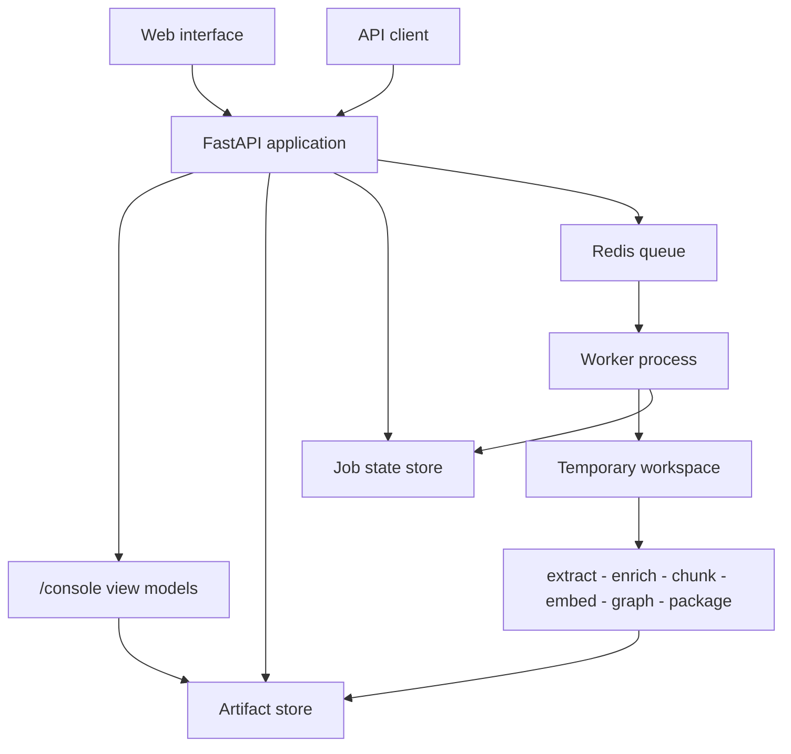

# Architecture

## Layers

Dependencies point in one direction only.

| Layer | Knows about | Never touches |
|---|---|---|
| `api` | schemas, state, storage | the filesystem, extraction internals |
| `web` | `api.common`, storage, view models | HTTP request shaping beyond its own router |
| `pipeline` | `docparse`, the output directory | HTTP, object storage, job state |
| `worker` | pipeline, storage, state, credentials | request handling |
| `storage` / `state` | their backend only | each other |
| `docparse` | file formats | CorpusRetrieve entirely |

`docparse` has no import of `corpusretrieve`. It stays reusable as a standalone
extraction library.

## Request flow

1. `POST /v1/jobs` validates the submission, expands a ZIP if present, and
   streams each accepted file into the artifact store under
   `jobs/{job_id}/inputs/`.
2. A per-request Anthropic key, if supplied, goes to the credential store:
   in-memory for inline mode, Fernet-encrypted in Redis with a TTL for queue
   mode.
3. The job is dispatched. Inline mode uses a FastAPI background task; queue mode
   enqueues onto Redis Queue.
4. The worker materialises inputs into a temporary directory, runs the pipeline,
   and uploads every produced file to `jobs/{job_id}/artifacts/`.
5. The temporary directory is destroyed. Inputs are deleted when
   `DELETE_INPUTS_AFTER_PROCESSING` is true. The credential is deleted
   unconditionally.

If any step fails, the partial object prefix and job state are removed before
the error is returned.

## Stage tracking

The pipeline reports through `StageTracker` rather than writing job state
directly. The tracker owns stage status, timing, and counters; the worker
supplies a sink that persists the snapshot. This keeps persistence out of the
processing code and means the same pipeline runs unchanged under a different
state backend or in a test with an in-memory list.

Stages one to three run per document in a single pass, so a large corpus never
holds every extraction result in memory at once. Their counters accumulate
across documents and are published after each one, which is why the interface
shows all three advancing together during the document pass.

## Storage boundary

The API server holds no index on local disk. Everything a job produces is an
object in the artifact store, addressed by
`jobs/{job_id}/artifacts/{relative path}`.

This is why the console reads artifacts rather than a database: there is no
second source of truth to keep synchronised, and any worker or API replica can
serve any job.

## Console layer

The browser needs shapes the integration API does not owe its consumers: chunk
lists trimmed for rendering, elements filtered by page, a graph with
bookkeeping nodes hidden and degrees precomputed, and a 2D projection of the
vectors.

Putting these in `/v1` would bloat a contract that integrators must implement
against. Putting them in the browser would ship the entire vector index to the
client. They live in `corpusretrieve/web/` instead: excluded from OpenAPI,
disableable, and built from the same stored artifacts through the same
`api.common` accessors.

The projection uses an SVD-based PCA written directly on NumPy, so the runtime
image needs no machine-learning framework. UMAP is used instead when it is
installed and there are enough points for it to be meaningful.

## Design decisions

**One upload endpoint.** Separate document, corpus, and archive endpoints would
force the caller to classify a submission before sending it. `POST /v1/jobs`
inspects what arrived and records the result as `submission_mode`.

**Artifacts before databases.** The primary output is a set of files that load
into any vector store or graph database. Nothing is locked behind a running
service.

**Protocols over inheritance.** `ArtifactStore` and `JobStore` are typing
Protocols. Adapters implement them structurally, and the factories import
concrete adapters lazily so a memory-backed run needs neither boto3 nor a Redis
client.

**Frozen settings.** `Settings` is an immutable dataclass validated once at
startup. A bad configuration fails at boot with a specific message rather than
at the first request that happens to touch it.

**No build step for the interface.** React and Babel are vendored. The trade-off
is a 2.8 MB transformer on first load in exchange for a project that installs
with pip alone and runs with no network access. Precompiling the JSX is the
route to take if that cost matters for a given deployment.
